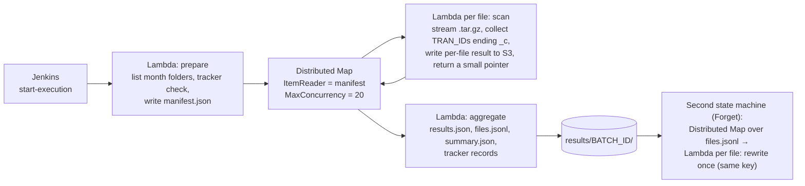

# Glue vs Step Functions + Lambda for `TRAN_ID_SUFFIX` (`_c`) mode

**The question:** for the `_c` mode only, would a Step Functions workflow that hands each part file to its own Lambda (20 files at a time) be more effective and cheaper than the current Glue Spark jobs?

**Short answer:**
- **Cost:** yes, Step Functions + Lambda on Arm is about **30–40% cheaper**. For the 3-month scenario that's ≈ $7.20 against Glue's ≈ $12.10, a saving of about **$3–5 per full 3-month run**.
- **Speed:** with only 20 files at a time it is **3–4× slower** than Glue's 100 at a time. Raising the concurrency to ~100 matches Glue's time **at the same cost**, because Lambda bills per millisecond of work whatever the concurrency.
- **Is it worth it?** Only if this pipeline runs often or at a much bigger scale (one year of data saves ≈ $24 per batch), or if you want to drop Glue altogether. Otherwise a few dollars per run doesn't pay for building and running a second orchestration stack. See [section 6](#6-recommendation).

Scenario, speeds and Glue numbers come from [SCENARIO_3_MONTHS_TRAN_ID_SUFFIX.md](SCENARIO_3_MONTHS_TRAN_ID_SUFFIX.md): 3 months × 800 parts × 100 MB `.tar.gz` (~500 MB CSV each), about **30 s per file for Find** and **90 s per file for Forget** on 1 vCPU. All figures are estimates until a pilot is measured.

| | |
|---|---|
| Date | 2026-11-18 |
| Region / prices | us-east-1 list prices, no free tier |

---

## 1. The Step Functions design being compared

| Setting | Value | Why |
|---|---|---|
| Lambda memory | **1,769 MB** | the size at which Lambda gives a full vCPU. The CSV pass is single-threaded Python, so this matches one Glue task slot (1 vCPU). |
| Architecture | **arm64** (Graviton) | 20% cheaper per GB-second than x86 |
| Ephemeral `/tmp` | 512 MB for scan, **2 GB for Forget** (rewrite needs ~500 MB CSV + ~100 MB archive in temp files) | |
| Timeout | 5 min (scan), 10 min (Forget) | the per-file work is 30 s / 90 s; Lambda's hard limit is 15 min |
| Child workflows | Standard, one Task state per file | ~4 state transitions per file, including the map iteration |

### Unit prices

| Service | Item | Price | Source |
|---|---|---|---|
| Lambda | compute, x86 / arm64 | $0.0000166667 / $0.0000133334 per GB-second | [Lambda pricing](https://aws.amazon.com/lambda/pricing/) |
| | requests | $0.20 per million | |
| | ephemeral storage above 512 MB | $0.0000000309 per GB-second | |
| Step Functions | Standard state transition (Distributed Map: 1 per iteration) | $0.000025 | [Step Functions pricing](https://aws.amazon.com/step-functions/pricing/) |
| Glue 5.0 | DPU-hour (G.1X = 1 DPU = 4 vCPU = 4 files at once) | $0.44 | [Glue pricing](https://aws.amazon.com/glue/pricing/) |

### What one second of work on one file costs

| Platform | Per file-second | Notes |
|---|---|---|
| Glue G.1X (1 of its 4 slots) | $0.44 / 3600 / 4 = **$0.0000306** | plus the driver, the ~75 s start-up of every run on all 26 DPUs, and idle slots while each wave waits for its slowest file |
| Lambda 1,769 MB x86 | 1.7275 GB × $0.0000166667 = **$0.0000288** | only the milliseconds actually used |
| Lambda 1,769 MB arm64 | 1.7275 GB × $0.0000133334 = **$0.0000230** | only the milliseconds actually used |

The raw compute price is almost the same. **Lambda's saving comes from paying nothing for start-up, the driver or waiting at wave barriers**, plus Arm's lower rate.

---

## 2. Cost per file

| | Find (30 s) | Forget (90 s) |
|---|---|---|
| Lambda arm64 compute | 30 × $0.0000230 = $0.00069 | 90 × $0.0000230 = $0.00207 |
| Lambda x86 compute | $0.00086 | $0.00259 |
| Extra `/tmp` (1.5 GB × 90 s) | - | $0.000004 |
| Lambda request | $0.0000002 | $0.0000002 |
| Step Functions (~4 transitions) | $0.0001 | $0.0001 |
| **Total per file, arm64** | **≈ $0.00079** | **≈ $0.00217** |

S3 requests are the same on both platforms: one GET per file for Find; a GET, a PUT and a marker PUT per file for Forget. Lambda adds one small PUT per file for its result. Either way it's cents (≈ $0.03–0.10 for the scenarios below).

---

## 3. Cost comparison

Worst case: every file contains `_c` rows, so Forget rewrites all of them.

### 3.1 One month (800 files)

| | Find | Forget | **Total** |
|---|---|---|---|
| Glue, `MAX_WAVES=5` (current), 26 workers | $1.32 | $2.84 | **$4.20** |
| Glue, `MAX_WAVES=0` (one run per job) | $1.08 | $2.60 | **$3.70** |
| Step Functions + Lambda x86 | $0.77 | $2.15 | **$2.95** |
| **Step Functions + Lambda arm64** | **$0.63** | **$1.74** | **$2.40** |

### 3.2 Three months (2,400 files)

| | Find | Forget | **Total** |
|---|---|---|---|
| Glue, `MAX_WAVES=5` (current), 26 workers | $3.71 | $8.28 | **$12.10** |
| Glue, `MAX_WAVES=0` | $2.75 | $7.33 | **$10.20** |
| Step Functions + Lambda x86 | $2.31 | $6.46 | **$8.90** |
| **Step Functions + Lambda arm64** | **$1.90** | **$5.22** | **$7.20** |

**Saving with Lambda arm64:** 3 months is $4.90 less than current Glue (−40%) or $3.00 less than Glue with `MAX_WAVES=0` (−30%). For one month: $1.80 (−43%) or $1.30 (−35%).

Old-version storage on the data lake bucket (e.g. $5.52 per month for 240 GB with `REPLACE_KEEP_VERSIONS`) is **the same on both platforms**. It depends on the Forget strategy, not on the compute. For long-term cost it matters more than the platform choice.

### 3.3 Scaled up (where the difference starts to matter)

| Files per batch (`_c` in every file) | Glue current | Lambda arm64 | Saving per batch |
|---|---|---|---|
| 2,400 (3 months) | $12.10 | $7.20 | $4.90 |
| 12,000 (1 year) | ≈ $60 | ≈ $36 | ≈ $24 |
| 48,000 (4 years) | ≈ $240 | ≈ $142 | ≈ $98 |

Glue for 12,000 files: 120 waves in 24 runs. Find = 24 × 75 + 120 × 33 = 5,760 s and Forget = 24 × 75 + 120 × 93 = 12,960 s, both on 26 DPU. Lambda = files × $0.00296.

---

## 4. Duration comparison

Lambda has no waves. Each file starts as soon as a slot frees up, so the run time ≈ files × seconds per file ÷ concurrency, plus a few seconds of cold start.

| | 1 month Find | 1 month Forget | 3 months Find | 3 months Forget |
|---|---|---|---|---|
| Glue (100 at once, 5 waves per run) | 7 min (2 runs) | 15 min (2 runs) | 19.5 min (5 runs) | 43.5 min (5 runs) |
| **Lambda, concurrency 20** (as proposed) | 800 × 30 / 20 = **20 min** | 800 × 90 / 20 = **60 min** | **60 min** | **3 h** |
| Lambda, concurrency 100 | 4 min | 12 min | 12 min | 36 min |
| Lambda, concurrency 200 | 2 min | 6 min | 6 min | 18 min |

**Lambda costs the same at any concurrency.** Raising it from 20 to 100 cuts the 3-month Forget from 3 h to 36 min for the same $5.22. The limits are the account's Lambda concurrency (1,000 by default, shared with every other function: set reserved concurrency) and S3 throughput (100 files × 100 MB in 30 s ≈ 330 MB/s, which S3 handles easily).

The Glue times are Glue compute only. With `MAX_WAVES=5`, each extra run also waits for someone (or something) to build Jenkins again. A single Step Functions execution runs to the end on its own.

---

## 5. Effectiveness beyond cost

| | Glue (current) | Step Functions + Lambda |
|---|---|---|
| Start-up | ~75 s per run, paid on all 26 DPUs | about 1 s cold start per Lambda container |
| Waiting | each wave waits for its slowest file | none: a slow file only delays itself |
| Failure of one file | recorded as FAILED; rerun with `RETRY_FAILED` | `Retry`/`Catch` per file, a tolerated-failure threshold, and **redrive** of only the failed items |
| Resume after stop | rerun with the same `BATCH_ID` (waves are kept) | redrive the execution; the tracker and markers skip finished files |
| Emergency stop | STOP switch checked before every wave, plus KILL | `StopExecution` (in-flight Lambdas finish their file); the STOP object can still be checked in each Lambda |
| Visibility | driver log lines, wave files, Jenkins status | per-file status in the Step Functions console, CloudWatch per Lambda |
| Limit per file | none in practice (64 GB disk, 8 h job timeout) | **15 min and 10 GB `/tmp` per file.** Fine for 100 MB parts (~90 s); a risk for parts larger than ~1 GB compressed. |
| Result size | the driver collects results in memory | **256 KB payload limit per state**: each Lambda must write its `_c` ID list to S3 and return only a pointer and counts; an aggregate Lambda then builds `results.json` / `files.jsonl` |
| Throttling | `FILES_PER_WAVE`, `MAX_WAVES`, `WORKERS` | `MaxConcurrency` (and reserved concurrency) |
| `HASH_MATCH` mode | supported | possible, but parsing and hashing the XML of every row is several times slower than the `_c` check (the guide's pilot figure is ~95 s per 100 MB part). On 500 MB CSVs that could approach the 15-min limit. Better kept on Glue. |
| Infrastructure | 2 Glue jobs, 2 roles, scripts | 2 state machines, 3–4 Lambda functions, their roles, log groups, packaging |

### How much of the current code carries over

Most of it. The per-file work is already plain Python with no Spark inside:
- `tasks.scan_task(shared, item)` and `tasks.forget_task(shared, item)` take one file and return a dict, so a Lambda handler can call them directly.
- `find_strategies`, `forget_strategies`, `tracking`, `formats`, `common` and `notify` are reused as they are.
- Only the **drivers** change: `find.py` and `forget.py` become a *prepare* Lambda, a *scan* or *rewrite* Lambda, an *aggregate* Lambda, and the state machine.
- Terraform (one module per resource) would get new `lambda-function` and `step-function` modules.
- Jenkins would call `aws stepfunctions start-execution` instead of `aws glue start-job-run`.

A rough estimate is **3–5 days** to build, test and document this for the `_c` mode, and longer if Forget moves too.

---

## 6. Recommendation

| If … | Choose |
|---|---|
| this runs a few times a year on a few months of data | **Keep Glue**, and set `MAX_WAVES=0` for one-off batches. That cuts 3 months from $12.10 to $10.20 with a parameter change. The extra saving from Lambda (~$3 per run) won't pay back several days of building and a second stack to maintain. |
| `_c` runs are frequent (e.g. weekly), or batches cover years of data | **Step Functions + Lambda (arm64) for `_c` mode.** It's 30–40% cheaper, has no start-up cost, retries per file and doesn't wait at wave barriers. Use concurrency **~100**, not 20, to keep run times like Glue's at no extra cost. |
| you want a single platform | Lambda for `_c` only means running **two** platforms while `HASH_MATCH` stays on Glue. Weigh the extra operational load against the saving. |
| parts may grow above ~1 GB compressed | **Glue**, because Lambda's 15-min and 10 GB `/tmp` per-file limits become a risk |

**Concurrency 20 specifically:** it costs the same as concurrency 100 but takes 5× longer (3 months: Find 1 h, Forget 3 h). Use 20 only to protect a shared Lambda concurrency limit or S3 request rates. Neither is a constraint at this size.

---

## 7. To confirm with a pilot

1. Time one 100 MB `.tar.gz` in a Lambda at 1,769 MB arm64: scan, then rewrite. The Lambda report gives `Billed Duration`.
2. Time the same file in Glue (wave line `slowest file`).
3. Put both into this table and redo sections 2–4.

| Date | File | Size (gz / CSV) | Platform | Step | Seconds | Cost per file |
|---|---|---|---|---|---|---|
| | | | Lambda arm64 1,769 MB | scan | | |
| | | | Lambda arm64 1,769 MB | rewrite | | |
| | | | Glue G.1X | scan | | |
| | | | Glue G.1X | rewrite | | |
