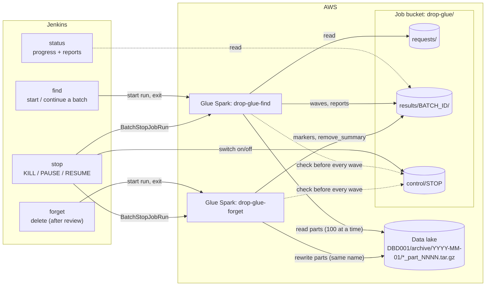
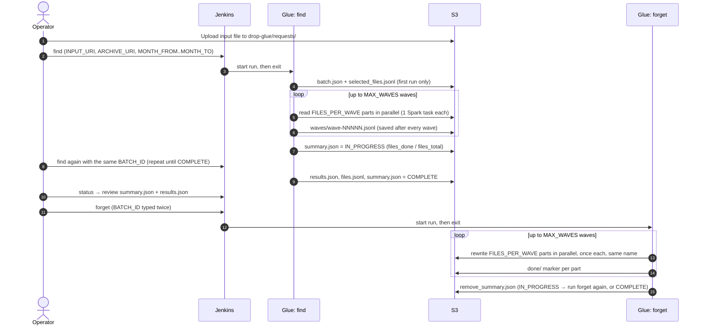
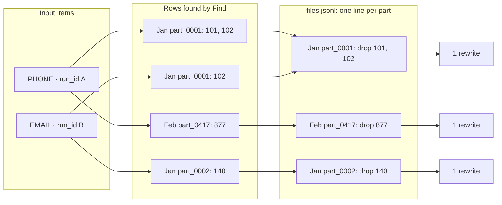
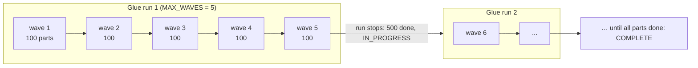
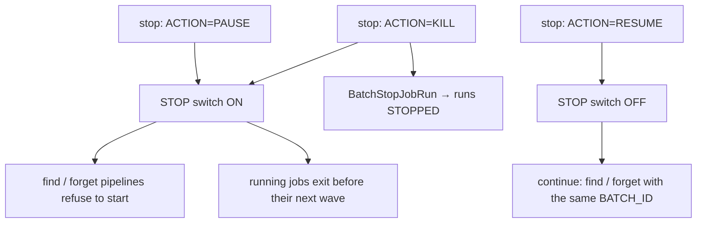
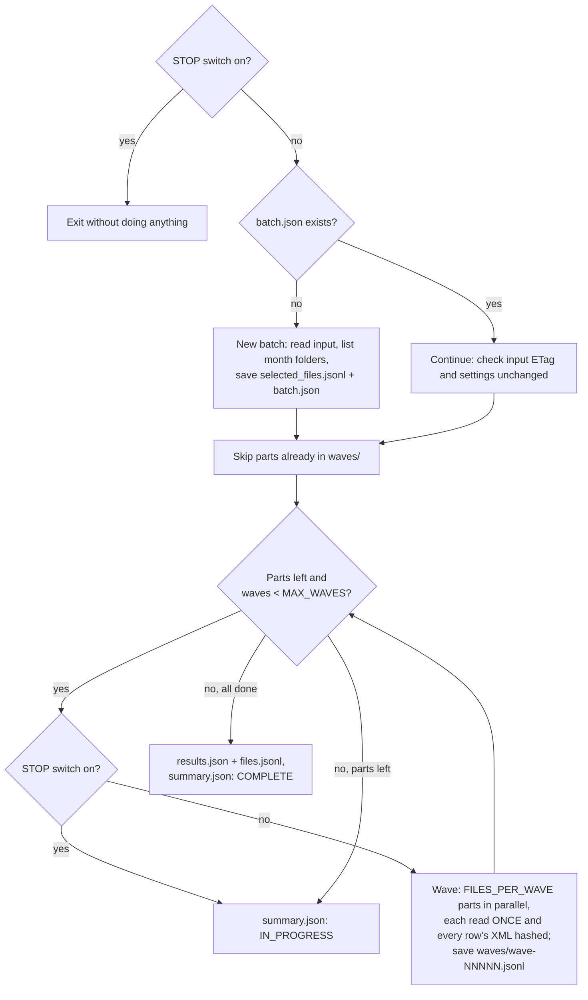
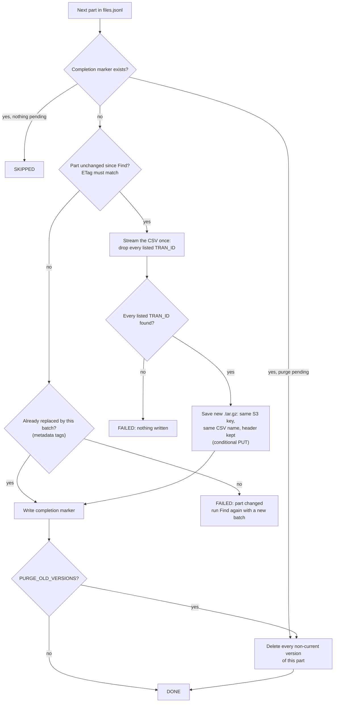
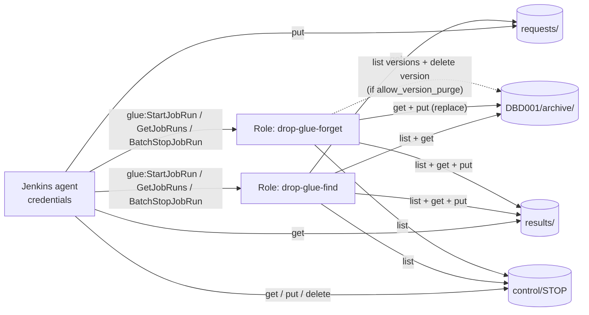

# drop-glue guide

How to find customer records in the S3 data lake by their SHA-256 hash, delete them, and replace each part file with a clean copy under the same name. Everything runs from Jenkins on AWS Glue (Spark); there's no Cognito, API or web UI.

**Contents**
1. [What this tool does](#1-what-this-tool-does)
2. [How a batch runs](#2-how-a-batch-runs)
3. [One part, one rewrite](#3-one-part-one-rewrite)
4. [How hashing works](#4-how-hashing-works)
5. [Throttling and sizing](#5-throttling-and-sizing)
6. [Emergency stop](#6-emergency-stop)
7. [One-time setup](#7-one-time-setup)
8. [Step 1: Find](#8-step-1-find)
9. [Step 2: Review](#9-step-2-review)
10. [Step 3: Forget](#10-step-3-forget)
11. [S3 layout](#11-s3-layout)
12. [Who can do what](#12-who-can-do-what)
13. [Troubleshooting](#13-troubleshooting)
14. [Changing the input/output format](#14-changing-the-inputoutput-format)
15. [Glossary](#15-glossary)

---

## 1. What this tool does

The monthly archive process runs on the 1st of each month and writes about 1,000 **part files** of about 100 MB each into a folder named after that date:

```text
s3://data-lake/DBD001/archive/2026-01-01/AB_CDEFG_DATA_01_part_0001.tar.gz   → contains AB_CDEFG_DATA_01_part_0001.csv
s3://data-lake/DBD001/archive/2026-01-01/AB_CDEFG_DATA_01_part_0002.tar.gz   → contains AB_CDEFG_DATA_01_part_0002.csv
...                                                                            (each CSV has its own header row)
```

Every CSV row has a unique `TRAN_ID`, and its `RAW_RESPONSE` column holds XML with the customer's phone, email, name and address.

| Piece | What it does |
|---|---|
| **Find** (`scripts/find.py`, Glue job `drop-glue-find`) | Scans every part file in the chosen months, hashes the values in each row's XML and compares them with your input hashes. It reports **MATCH / NO_MATCH / ERROR** per input item, with every part file and transaction ID where the customer was found. It also prepares a **work list with one line per part file**. |
| **Forget** (`scripts/forget.py`, Glue job `drop-glue-forget`) | For each part in the work list, **once**, it loads the part, drops the listed transaction IDs, and saves a new `.tar.gz` under the **same S3 key with the same CSV name inside**. |
| `scripts/tasks.py` | The work for one part file, run inside Spark tasks |
| `scripts/common.py`, `scripts/formats.py` | Shared helpers, and all JSON layouts |
| 4 Jenkins pipelines | **find**, **status**, **forget** and **stop**. They start a job and exit without waiting. |



**What Terraform creates** (11 resources):
- The 5 script files in S3.
- 2 Glue 5.0 Spark jobs.
- 2 least-privilege IAM roles, each with 1 policy.

Optionally it also creates the Glue log groups. It creates **no** buckets, Cognito, API Gateway, Lambda, Step Functions, DynamoDB or ECS.

---

## 2. How a batch runs

A **batch** is one input file applied to one month range. It has a `BATCH_ID`, which is also its report folder. Each Glue run is **capped** (see [section 5](#5-throttling-and-sizing)), so a large batch takes several runs. Each run continues where the last one stopped.



---

## 3. One part, one rewrite

However many customers or rows a part file contains, it is **read once and rewritten once**. Find merges everything per part, and Forget then works part by part. Parts without matches are never touched.



Every matching row counts as a separate find. If a phone number appears in 5 rows, `results.json` lists all 5 transaction IDs and `match_count` is 5.

---

## 4. How hashing works

The input contains **no plaintext**, only `hash_value`, which is the **SHA-256** of the customer's data. For each row, Find:

1. Parses the `RAW_RESPONSE` XML. XML that contains a `<!DOCTYPE …>` is rejected for safety.
2. Takes the text of every element whose name belongs to a match type:

   | match_type | XML element names (case-insensitive, namespace ignored) | Glue argument to change them |
   |---|---|---|
   | PHONE | `phone`, `phoneNumber` | `--phone_tags` |
   | EMAIL | `email`, `emailAddress` | `--email_tags` |
   | NAME | `name`, `fullName` | `--name_tags` |
   | ADDRESS | `address`, `fullAddress` | `--address_tags` |

3. Prepares the text according to `HASH_MODE`:

   | HASH_MODE | PHONE | EMAIL | NAME / ADDRESS |
   |---|---|---|---|
   | `normalized` (default) | digits only (`+1 (202) 555-0134` → `12025550134`) | trimmed, lowercase | trimmed, lowercase, repeated spaces collapsed to one |
   | `raw` | exact text, trimmed | exact text, trimmed | exact text, trimmed |

4. Computes `sha256(text as UTF-8)` as **64 lowercase hex characters** and compares it with every input hash of that type. Input hashes may be uppercase or lowercase.

> ⚠ **Agree this rule with the team that produces `hash_value`.** If they hash differently (for example, phone with a `+`, or email without lowercasing), nothing will match. Every item will come back as NO_MATCH, with no error. Test with one known customer first.

Example: PHONE `+1 (202) 555-0134` in normalized mode is hashed as `12025550134`, which gives
`3382c7633f018e63e40b46a20b112be10d9fa0624d6d8f2f73ef65432475493f`.

To check a value yourself:
- **Linux/macOS:** `printf '%s' '12025550134' | sha256sum`
- **PowerShell:** `[BitConverter]::ToString([Security.Cryptography.SHA256]::Create().ComputeHash([Text.Encoding]::UTF8.GetBytes('12025550134'))).Replace('-','').ToLower()`

**ADDRESS** is currently read from a single element. If your XML splits an address across several elements, the joining rule must be agreed and added to `tasks.find_hits`.

---

## 5. Throttling and sizing

Spark is used as a **parallel engine**: one Spark task processes one part file. Spark can't read `.tar.gz` archives, and the data is inside XML, so Spark's own readers and SQL aren't used. Three settings control the load:

| Setting | Default (Terraform) | Per run (Jenkins) | Meaning |
|---|---|---|---|
| Files per wave | `default_files_per_wave = 100` | `FILES_PER_WAVE` | Part files processed at the same time |
| Waves per run | `default_max_waves = 5` | `MAX_WAVES` | After this many waves the run **stops cleanly** (`0` = no limit). 100 × 5 = **at most 500 files per run**. |
| Workers | `default_workers = 26` | `WORKERS` | Glue G.1X workers including 1 driver. Each worker runs 4 files at once, so 1 + 25 × 4 = 100. |
| Run timeout | `find_timeout` / `forget_timeout = 480` min | n/a | The last-resort automatic stop |



**Workers and wave size go together.** `WORKERS = FILES_PER_WAVE ÷ 4 + 1`. Fewer workers just means the wave takes longer; more workers than that sits idle.

| Files at once | WORKERS (G.1X) | DPU-hours per hour |
|---|---|---|
| 20 | 6 | 6 |
| 50 | 14 | 14 |
| 100 | 26 | 26 |
| 200 | 51 | 51 |

**Sizing with a pilot run.** The key number is how long one 100 MB part takes, which depends on how heavy the XML is. Measure it before the first real batch:

1. Run Find on one month with `FILES_PER_WAVE=20`, `MAX_WAVES=1`, `WORKERS=6`.
2. In the CloudWatch log (`/aws-glue/jobs/output`) the wave line shows, for example, `wave-00001.jsonl: 20 files (0 failed) in 190s, 2000 MB (10.5 MB/s), slowest file 185s`. Every file in `waves/` also records its own `seconds` and `rows`.
3. Estimate the time for a full batch as `parts × seconds per part ÷ files at once`. For example, 3,000 parts × 180 s ÷ 100 = 5,400 s ≈ **1.5 h** of processing. With the defaults (500 parts per run) that's **6 Find runs** of about 15 minutes each (5 waves × ~180 s).
4. Estimate the cost as `WORKERS × hours × price per DPU-hour`. For example, 26 × 1.5 × $0.44 ≈ **$17**. Check your region's price.

Forget only touches the parts that matched, usually far fewer than Find scanned. Each Forget task needs local disk for one uncompressed part and its replacement, which fits within the 64 GB of a G.1X worker.

---

## 6. Emergency stop

The **stop** pipeline (`jenkins/Jenkinsfile.stop`) is the hard stop. It controls a **stop switch**, an S3 object at `s3://JOB_BUCKET/drop-glue/control/STOP`:

| ACTION | Effect |
|---|---|
| **KILL** | Turns the switch **on**, then calls Glue `BatchStopJobRun` on running runs. Use `JOBS` to choose find, forget or both, and `BATCH_ID` to limit it to one batch. Glue ends the runs within moments. |
| **PAUSE** | Turns the switch **on** only. Running jobs finish and save their current wave, then exit. |
| **RESUME** | Turns the switch **off**. You must type `RESUME` in `CONFIRM`. |

While the switch is on:
- The find and forget pipelines **refuse to start**.
- The Glue jobs exit at start-up and **before every wave**.

Nothing restarts by accident, and the `status` pipeline shows that the switch is on.



**Why stopping is safe:**
- **Find:** finished waves are already saved, so a KILL mid-wave loses only that wave, which is redone on the next run.
- **Forget:**
  - Each replacement is a single conditional S3 write, so a part is either fully replaced or untouched.
  - If a run is killed after the write but before its completion marker, the next run recognises the part from its metadata tags (`drop-glue-batch`, `drop-glue-source-etag`). It then records the part as done without rewriting it again.

---

## 7. One-time setup

### 7.1 Prerequisites checklist

| ✔ | Item | Notes |
|---|---|---|
| ☐ | **Data lake bucket** (existing) | Parts under one prefix, e.g. `DBD001/archive/YYYY-MM-01/`. **Turn on versioning** so a bad replacement can be recovered. |
| ☐ | **Job bucket** (existing) | Holds the scripts, input files, reports and the stop switch under `drop-glue/`. It can be the same bucket as the data lake, as long as the prefixes are separate. |
| ☐ | **KMS** (if the buckets use SSE-KMS) | Add both Glue role ARNs (`terraform output role_arns`) to the key policy: `kms:Decrypt` for find, and `kms:Decrypt` + `kms:GenerateDataKey` for forget. Rewritten parts use the bucket's **default** encryption. |
| ☐ | **Bucket policies** | If they restrict principals, allow the two Glue roles. |
| ☐ | **Glue capacity quota** | Your account's maximum DPUs must cover `WORKERS` (default 26). |
| ☐ | **Jenkins agent** | AWS CLI v2, the *Pipeline Utility Steps* plugin, and AWS credentials with the permissions in [section 12](#12-who-can-do-what). |
| ☐ | **Terraform** ≥ 1.5 | AWS provider 6.x. |
| ☐ | **Hashing rule agreed** | See [section 4](#4-how-hashing-works). |

### 7.2 Deploy

```text
cp terraform.tfvars.example terraform.tfvars     # then edit the bucket names / region
terraform init
terraform fmt -check -recursive
terraform validate
terraform plan -out=drop-glue.tfplan              # review: 11 resources
terraform apply drop-glue.tfplan
terraform output
```

Expected output (values differ):

```text
job_names      = { "find" = "drop-glue-find", "forget" = "drop-glue-forget" }
request_prefix = "s3://my-job-bucket/drop-glue/requests/"
result_prefix  = "s3://my-job-bucket/drop-glue/results/"
stop_uri       = "s3://my-job-bucket/drop-glue/control/STOP"
role_arns      = { "find" = "arn:aws:iam::111122223333:role/drop-glue-find", "forget" = "..." }
```

> **Upgrading from an earlier version:** the jobs change from Python shell to Spark, so they're updated in place. The old `drop-glue-match`/`drop-glue-remove` jobs and roles from the first version are replaced.

### 7.3 Create the Jenkins jobs

| Jenkins job | Script path |
|---|---|
| `drop-glue-find` | `jenkins/Jenkinsfile.find` |
| `drop-glue-status` | `jenkins/Jenkinsfile.status` |
| `drop-glue-forget` | `jenkins/Jenkinsfile.forget` |
| `drop-glue-stop` | `jenkins/Jenkinsfile.stop` |

1. Create each one as a Pipeline job using *Pipeline script from SCM*.
2. Run each once so Jenkins registers its parameters.
3. Set the defaults for `GLUE_JOB`/`FIND_JOB`/`FORGET_JOB`, `RESULT_PREFIX`, `STOP_URI`, `AWS_REGION` and `WORKER_TYPE` from the Terraform outputs.
4. Restrict who can build `drop-glue-forget` and `drop-glue-stop`.

### 7.4 Recommended: expire old files

Reports contain transaction IDs and hashes. Add a lifecycle rule to the job bucket that expires `drop-glue/requests/` and `drop-glue/results/` after an agreed period. Do this in the bucket's own configuration. Terraform doesn't do it here, because adding a rule from this project would replace any lifecycle rules the bucket already has.

---

## 8. Step 1: Find

### 8.1 Prepare the input file

Upload a JSON array to `s3://JOB_BUCKET/drop-glue/requests/` (full example: [`examples/input.json`](../examples/input.json)):

```json
[
  {"run_id": "6f1c2a7e-4b8d-4c1e-9a3f-2d5e8b7c1a90", "hash_value": "3382c7633f018e63e40b46a20b112be10d9fa0624d6d8f2f73ef65432475493f", "match_type": "PHONE"},
  {"run_id": "a2b9d4c1-7e3f-4a6b-8c2d-1f0e9b8a7c65", "hash_value": "86e0b9e56c17cc4d12387e1949b85053fbe73bc3ce5a1188713a9d300cc6133d", "match_type": "EMAIL"}
]
```

| Field | Rule |
|---|---|
| `run_id` | Your tracking ID for this item, e.g. a UUID. It's echoed in the results. |
| `hash_value` | SHA-256 of the customer value: 64 hex characters ([section 4](#4-how-hashing-works)) |
| `match_type` | `EMAIL`, `PHONE`, `NAME` or `ADDRESS` |

An invalid item gives an **ERROR** result for that item only; the rest of the batch still runs. **Don't change the file while its batch is running.** Find checks the file's ETag on every run and refuses to continue if it has changed.

### 8.2 Start a batch

Build **drop-glue-find**:

| Parameter | Example | Meaning |
|---|---|---|
| `BATCH_ID` | (empty) | Empty starts a **new** batch named `<job>-<build number>` |
| `INPUT_URI` | `s3://JOB_BUCKET/drop-glue/requests/batch-2026-11-16.json` | The file from 8.1 |
| `ARCHIVE_URI` | `s3://data-lake/DBD001/archive/` | The archive folder, or a single part file |
| `MONTH_FROM` / `MONTH_TO` | `2026-01` / `2026-03` | Inclusive. The folder `2026-01-01` belongs to month `2026-01`. **Leave both empty to scan the whole archive.** |
| `HASH_MODE` | `auto` | `auto` means `normalized` for a new batch ([section 4](#4-how-hashing-works)) |
| `FILES_PER_WAVE` / `MAX_WAVES` / `WORKERS` | (empty) | Empty uses the Terraform defaults ([section 5](#5-throttling-and-sizing)) |

The build prints the batch ID and the Glue run ID, then **exits**. The Glue run carries on in AWS.

### 8.3 Continue a batch

When `status` shows `IN_PROGRESS`, build **drop-glue-find** again with **`BATCH_ID` set** and the other fields empty. The batch remembers its input, archive, months and hash mode, and passing a different value is refused. Only one run of each job can be active at a time.

`RETRY_FAILED=true` scans parts that failed in earlier runs again, for example after a temporary S3 error. This is allowed until Forget has started on the batch.

### 8.4 What Find does in each run



An unreadable part (corrupt archive, wrong inner CSV name, bad CSV row or invalid XML) is recorded as **FAILED** in its wave file, and the batch carries on.

### 8.5 The outputs (in `results/<BATCH_ID>/`)

**`results.json`** (when COMPLETE) has one entry per input item, in input order ([`examples/results.json`](../examples/results.json)):

```json
{
  "run_id": "6f1c2a7e-…",
  "hash_value": "3382c763…",
  "match_type": "PHONE",
  "match_result": "MATCH",
  "match_count": 3,
  "data_identifier": {
    "s3://data-lake/DBD001/archive/2026-01-01/AB_CDEFG_DATA_01_part_0001.tar.gz": ["101", "102"],
    "s3://data-lake/DBD001/archive/2026-02-01/AB_CDEFG_DATA_02_part_0417.tar.gz": ["877"]
  }
}
```

| match_result | When |
|---|---|
| `MATCH` | Found in at least one row. Every matching transaction ID is listed by part file, and `match_count` is the total. |
| `NO_MATCH` | Every part in scope was scanned and none matched |
| `ERROR` | The item is invalid (see `error`), **or** some part couldn't be scanned and the item wasn't found elsewhere, so NO_MATCH can't be confirmed |

**`files.jsonl`** (when COMPLETE) is the work list for Forget, with one line per part to rewrite ([`examples/files.jsonl`](../examples/files.jsonl)).

**`summary.json`** shows progress and counts, with `status` IN_PROGRESS or COMPLETE ([`examples/summary.json`](../examples/summary.json)).

The working files `batch.json`, `selected_files.jsonl` and `waves/*.jsonl` are explained in [section 11](#11-s3-layout).

---

## 9. Step 2: Review

Build **drop-glue-status** with the `BATCH_ID`. It shows:
- whether the stop switch is on
- every Glue run of the batch, with its state, duration, worker count and any error
- Find's progress and counts, and Forget's progress if it has started

It also attaches `summary.json`, `results.json` and `remove_summary.json` as build artifacts.

**Before you run Forget, check:**
- `status` is `COMPLETE` and `files_done` equals `files_total`.
- `failed_files` is empty. If it isn't, those parts were **not** included; use `RETRY_FAILED` before starting Forget.
- `skipped_folders` doesn't include folders you meant to scan.
- **All NO_MATCH?** Suspect the hashing rule ([section 4](#4-how-hashing-works)) before assuming the customers aren't in the data.
- `rows_to_delete` and the `match_count` values aren't suspiciously high. A common NAME can match many people.

---

## 10. Step 3: Forget

Build **drop-glue-forget**:

| Parameter | Meaning |
|---|---|
| `BATCH_ID` / `CONFIRM_BATCH_ID` | The batch to apply, typed twice as a safety check. Find must be COMPLETE. |
| `PURGE_OLD_VERSIONS` | `true` also deletes the **old S3 versions** of each rewritten part, so the data is truly gone. **This can't be undone.** With `false`, old versions remain until a bucket lifecycle rule expires them. |
| `FILES_PER_WAVE` / `MAX_WAVES` / `WORKERS` | Throttling, as in Find |

The build exits after starting the run. If `remove_summary.json` (shown by `status`) says `IN_PROGRESS`, build Forget again with the same batch. Finished parts are skipped.

### 10.1 Safety checks for each part



**What's kept in the new part:**
- The S3 key and the CSV name inside the archive.
- The header row and column order, and every other row unchanged.
- The tar entry's timestamp and permissions.
- The object's content type and user metadata.

Two user-metadata tags are added: `drop-glue-batch` and `drop-glue-source-etag`. S3 object **tags** aren't copied. A part whose rows are all deleted is kept with just its header row.

`remove_summary.json` reports the outcome for each part (DONE, SKIPPED, FAILED or PENDING) and an overall `status`:
- **COMPLETE**: every part is done.
- **IN_PROGRESS**: parts are left, so run Forget again.
- **INCOMPLETE**: some parts failed; the Glue run is marked failed.

> **About versions:** if the data lake bucket is versioned and you don't purge, the deleted rows still exist in the previous versions. Either set `PURGE_OLD_VERSIONS=true` or add a lifecycle rule that expires non-current versions.

---

## 11. S3 layout

```text
s3://JOB_BUCKET/drop-glue/
├── scripts/<sha256>/{find,forget,tasks,common,formats}.py   ← uploaded by Terraform
├── control/STOP                          ← emergency stop switch (exists = ON)
├── requests/
│   └── batch-2026-11-16.json             ← input file (you; don't change during a batch)
└── results/
    └── drop-glue-find-42/                ← one folder per BATCH_ID
        ├── batch.json                    ← fixed settings (first run)
        ├── selected_files.jsonl          ← the parts in the month range (first run)
        ├── waves/wave-00001.jsonl …      ← per-part scan results, one file per wave
        ├── summary.json                  ← progress; COMPLETE when done
        ├── results.json                  ← one entry per input item (COMPLETE)
        ├── files.jsonl                   ← work list: one line per part (COMPLETE)
        ├── done/<sha256(uri)>.json       ← one marker per rewritten part (forget)
        └── remove_summary.json           ← forget progress and outcome

s3://DATA_LAKE/DBD001/archive/            ← source_prefix: the ONLY place the jobs may read or rewrite
├── 2026-01-01/AB_CDEFG_DATA_01_part_0001.tar.gz … _part_1000.tar.gz
├── 2026-02-01/AB_CDEFG_DATA_02_part_0001.tar.gz …
└── ...
```

---

## 12. Who can do what



**Jenkins agent policy** (create this in your own IAM setup; Terraform doesn't create it):

```json
{
  "Version": "2012-10-17",
  "Statement": [
    {"Effect": "Allow", "Action": ["glue:StartJobRun", "glue:GetJobRun", "glue:GetJobRuns", "glue:BatchStopJobRun"],
     "Resource": "arn:aws:glue:REGION:ACCOUNT:job/drop-glue-*"},
    {"Effect": "Allow", "Action": "s3:PutObject", "Resource": "arn:aws:s3:::JOB_BUCKET/drop-glue/requests/*"},
    {"Effect": "Allow", "Action": "s3:GetObject", "Resource": "arn:aws:s3:::JOB_BUCKET/drop-glue/results/*"},
    {"Effect": "Allow", "Action": ["s3:GetObject", "s3:PutObject", "s3:DeleteObject"],
     "Resource": "arn:aws:s3:::JOB_BUCKET/drop-glue/control/*"}
  ]
}
```

The Glue roles can only list inside their own prefixes. They can't touch anything outside `source_prefix`, and each job allows only one run at a time.

---

## 13. Troubleshooting

Glue logs are in CloudWatch, under the Glue run ID that the Jenkins console prints:
- `/aws-glue/jobs/output`: driver progress, with one line per wave
- `/aws-glue/jobs/error`
- `/aws-glue/jobs/logs-v2`: continuous logs

| Symptom / message | Meaning | What to do |
|---|---|---|
| Every item is `NO_MATCH` | The hashing rule doesn't match the upstream one | Check [section 4](#4-how-hashing-works) with one known customer; try `HASH_MODE=raw` in a new batch |
| `The STOP switch is ON` | Someone ran KILL or PAUSE | Find out why; then run stop with `ACTION=RESUME` |
| `summary.json` stays `IN_PROGRESS` | Each run is capped by `MAX_WAVES` | Build find again with the same `BATCH_ID` |
| `… differs from this batch` | You passed a different input, archive, month or hash mode while continuing | Leave those fields empty to continue, or start a new batch |
| `The input file changed since this batch started` | The input was edited mid-batch | Start a new batch |
| `Find for batch … is IN_PROGRESS, not COMPLETE` | Forget was started too early | Finish Find first |
| `failed_files`: `Expected a single CSV named …_part_0001.csv` | The archive's inner file name doesn't match the part name | Investigate that part |
| `failed_files`: other errors | A corrupt part, bad CSV row or invalid XML, or a temporary S3 error | Fix it if needed, then rerun find with `RETRY_FAILED=true` (before Forget) |
| ERROR `N file(s) could not be scanned …` | See `failed_files` | As above |
| Forget: `part changed since Find ran (ETag mismatch)` | Someone rewrote the part after Find | Run a new Find batch for those customers |
| Forget: `N listed transaction IDs are missing` | The rows are no longer in the part | Investigate; the part was left untouched |
| Glue `ConcurrentRunsExceededException` | A run of that job is already active | Wait for it, or KILL it |
| Glue `ResourceNumberLimitExceededException` | Not enough Glue capacity in the account | Lower `WORKERS` and `FILES_PER_WAVE`, or raise the quota |
| Glue `TIMEOUT` | The run took longer than the timeout | Lower `MAX_WAVES`, or raise `find_timeout` / `forget_timeout` |
| `AccessDenied` | IAM, bucket policy or KMS | Check section 7.1 and section 12 |

---

## 14. Changing the input/output format

The formats are expected to change. All code that knows the JSON layouts is in **[`scripts/formats.py`](../scripts/formats.py)**; the other scripts work on internal structures (`Request`, `FileHits`).

| You change… | Edit in `formats.py` | Example file |
|---|---|---|
| The input file | `parse_input()` | `examples/input.json` |
| `results.json` | `result_entry()` | `examples/results.json` |
| `files.jsonl` | `file_line()`, `parse_file_line()` | `examples/files.jsonl` |
| `summary.json` | `build_summary()`, `parse_summary()` | `examples/summary.json` |
| `remove_summary.json` | `build_remove_summary()` | `examples/remove_summary.json` |
| `batch.json` / wave files | `build_batch()`, `wave_line()`, `parse_wave_line()` | `examples/batch.json`, `examples/wave-00001.jsonl` |
| How MATCH/NO_MATCH/ERROR is decided | `decide()` in `find.py` | `examples/results.json` |

**Checklist**
1. Edit the example in [`examples/`](../examples/) to the new shape.
2. Update the matching function(s).
3. If old files must stay readable, add the new version to `SUPPORTED_SCHEMA_VERSIONS` and branch on `schema_version`. Otherwise bump `SCHEMA_VERSION`. Batches started with the old version must finish before the upgrade.
4. Run `pytest tests/`. `tests/test_formats.py` fails until the examples and the code agree.
5. Update section 8 of this guide, and the `readJSON` fields in `jenkins/Jenkinsfile.status` and `Jenkinsfile.forget` if you renamed any `summary.json` field.
6. Run `terraform apply` to upload the new scripts. Their S3 folders are content hashes, so the jobs switch to them atomically.

---

## 15. Glossary

| Term | Meaning |
|---|---|
| **Part file** | One `…_part_NNNN.tar.gz` (about 100 MB) holding `…_part_NNNN.csv` with a header row |
| **run_id** | Your tracking ID for one input item, echoed in `results.json` |
| **Batch / BATCH_ID** | One input file applied to one month range. It may take several Glue runs, and its ID is the report folder name. |
| **Wave** | A group of `FILES_PER_WAVE` parts processed in parallel; its results are saved before the next one starts |
| **Work list** | `files.jsonl`: one line per part, with every `TRAN_ID` to drop from it |
| **Stop switch** | `drop-glue/control/STOP`. While it exists, nothing starts and running jobs stop before their next wave. |
| **ETag** | S3's fingerprint of an object. Forget only rewrites a part whose ETag still matches the one recorded by Find. |
| **Conditional PUT** | An S3 write that succeeds only if the object hasn't changed (`If-Match`) or doesn't exist yet (`If-None-Match`) |
| **Non-current version** | An older copy kept by S3 versioning. It still contains the deleted rows until purged or expired. |
| **Completion marker** | `done/<hash>.json`: proof that a part was rewritten, used to skip it on reruns |
| **G.1X worker / DPU** | Glue capacity unit: 4 vCPU and 16 GB. One worker is the Spark driver; each other worker runs 4 parts at once. |
| **source_prefix** | The only data lake prefix the jobs may read or rewrite (a Terraform variable) |

---

**Running the tests** (no AWS or Spark needed): `pip install pytest`, then `pytest tests/`.
