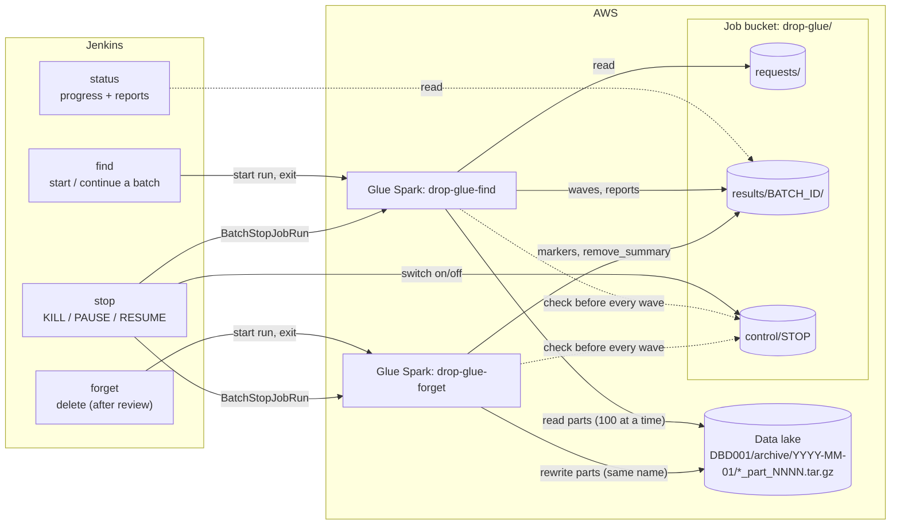
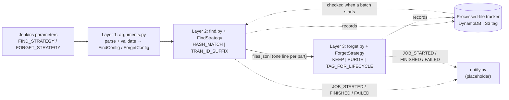
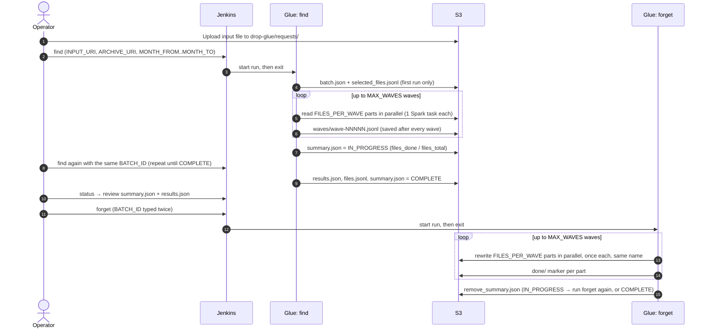
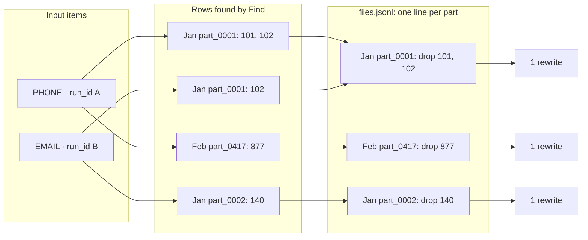
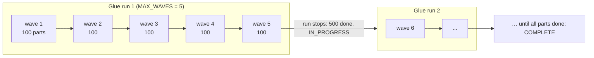
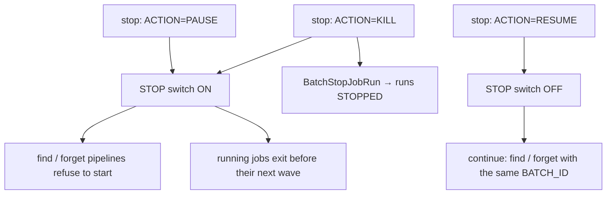
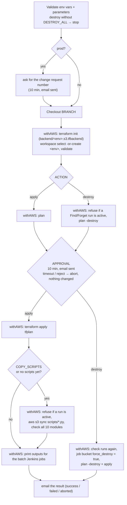
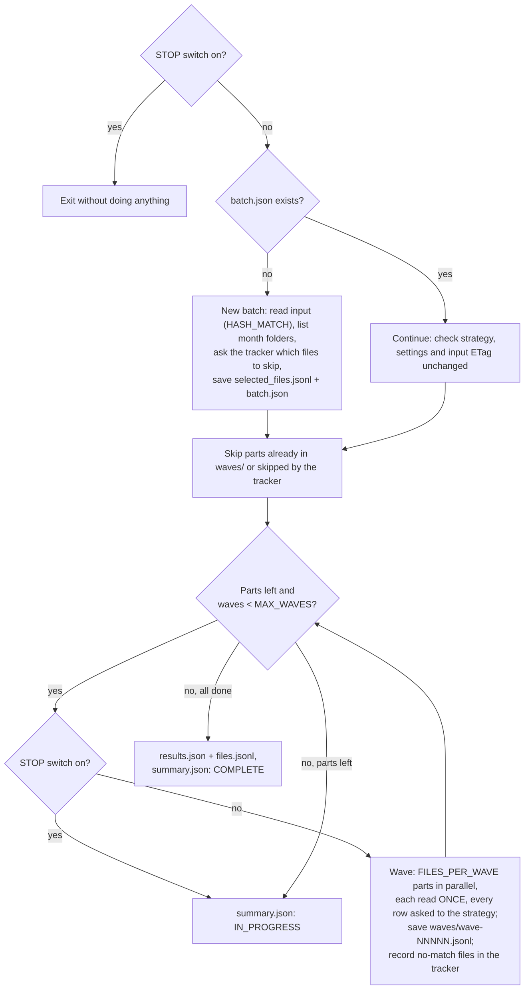
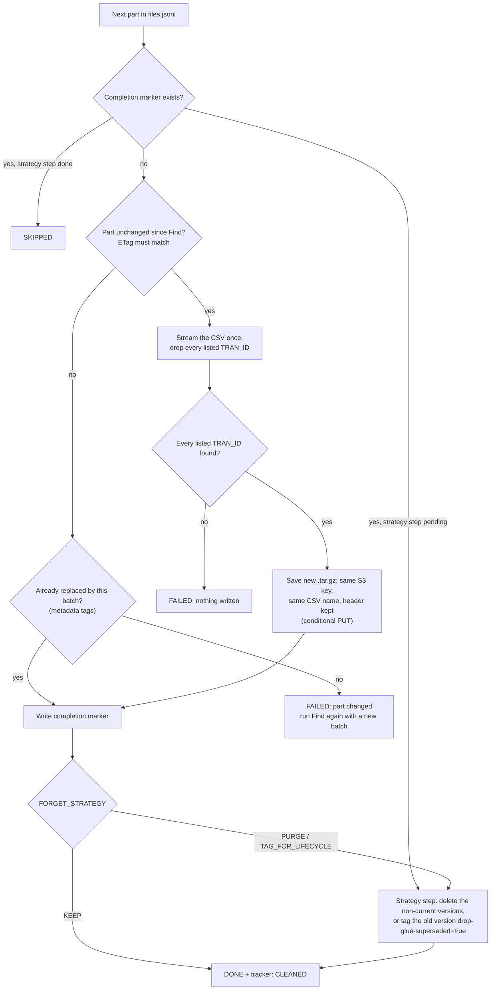
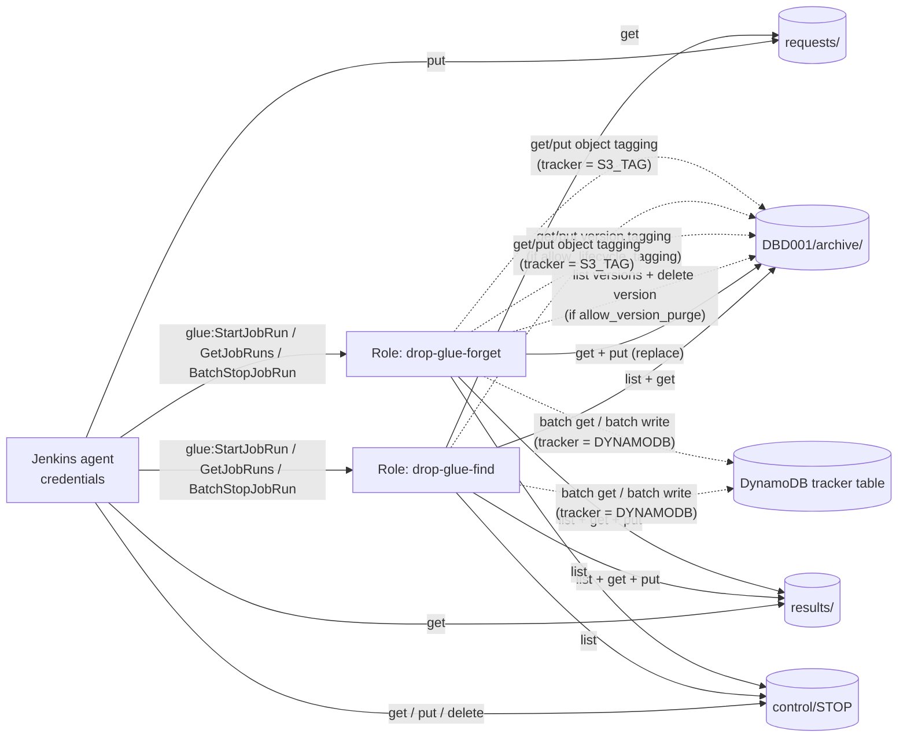

# drop-glue guide

How to find customer records in the S3 data lake by their SHA-256 hash, delete them, and replace each part file with a clean copy under the same name. Everything runs from Jenkins on AWS Glue (Spark); there's no Cognito, API or web UI.

**Contents**
1. [What this tool does](#1-what-this-tool-does)
2. [How a batch runs](#2-how-a-batch-runs)
3. [One part, one rewrite](#3-one-part-one-rewrite)
4. [How hashing works](#4-how-hashing-works)
5. [Throttling and sizing](#5-throttling-and-sizing)
6. [Emergency stop](#6-emergency-stop)
7. [One-time setup](#7-one-time-setup)
8. [Step 1: Find](#8-step-1-find)
9. [Step 2: Review](#9-step-2-review)
10. [Step 3: Forget](#10-step-3-forget)
11. [S3 layout](#11-s3-layout)
12. [Who can do what](#12-who-can-do-what)
13. [Troubleshooting](#13-troubleshooting)
14. [Changing the input/output format](#14-changing-the-inputoutput-format)
15. [Glossary](#15-glossary)

---

## 1. What this tool does

The monthly archive process runs on the 1st of each month and writes about 1,000 **part files** of about 100 MB each into a folder named after that date:

```text
s3://data-lake/DBD001/archive/2026-01-01/AB_CDEFG_DATA_01_part_0001.tar.gz   → contains AB_CDEFG_DATA_01_part_0001.csv
s3://data-lake/DBD001/archive/2026-01-01/AB_CDEFG_DATA_01_part_0002.tar.gz   → contains AB_CDEFG_DATA_01_part_0002.csv
...                                                                            (each CSV has its own header row)
```

Every CSV row has a unique `TRAN_ID`, and its `RAW_RESPONSE` column holds XML with the customer's phone, email, name and address.

| Piece | What it does |
|---|---|
| **Find** (`scripts/find.py`, Glue job `drop-glue-find-<env>`) | Scans every part file in the chosen months with the chosen **find strategy** ([1.2](#12-find-strategies)): by default it hashes the values in each row's XML and compares them with your input hashes, reporting **MATCH / NO_MATCH / ERROR** per input item with every part file and transaction ID where the customer was found. It also prepares a **work list with one line per part file**. |
| **Forget** (`scripts/forget.py`, Glue job `drop-glue-forget-<env>`) | For each part in the work list, **once**, it loads the part, drops the listed transaction IDs, and saves a new `.tar.gz` under the **same S3 key with the same CSV name inside**. The **forget strategy** ([1.3](#13-forget-strategies)) decides what happens to the old S3 version. |
| `scripts/arguments.py` | Layer 1: parses and validates the job arguments |
| `scripts/find_strategies.py`, `scripts/forget_strategies.py` | The strategies (one class each) |
| `scripts/tasks.py` | The work for one part file, run inside Spark tasks |
| `scripts/tracking.py`, `scripts/notify.py` | Processed-file tracker ([1.4](#14-processed-file-tracker)) and notifications ([1.5](#15-notifications-placeholder)) |
| `scripts/common.py`, `scripts/formats.py` | Shared helpers, and all JSON layouts |
| 4 Jenkins pipelines | **find**, **status**, **forget** and **stop**. They start a job and exit without waiting. |



**What Terraform creates** (one module per resource, provisioned by the root `Jenkinsfile`, see [7.2](#72-deploy)):
- The **job bucket** `<job_bucket>-<env>`: versioned, encrypted, public access blocked, ACLs disabled.
- 2 Glue 5.0 Spark jobs, each with its own CloudWatch log group.
- 2 least-privilege IAM roles, each with 1 policy.
- 1 DynamoDB table for the processed-file tracker (when `tracker = "DYNAMODB"`, the default).

Optionally it also creates a lifecycle rule on the source bucket (`manage_source_lifecycle`) and an EventBridge rule for failed runs (`notification_topic_arn`). The **scripts** aren't Terraform resources: the provisioning pipeline copies `scripts/*.py` into the job bucket (`COPY_SCRIPTS`). It creates **no** Cognito, API Gateway, Lambda, Step Functions or ECS, and it never creates or deletes the archive bucket.

### 1.1 Three layers

The tool is a batch framework built on the **Strategy pattern**: each layer depends on an interface, and the Jenkins drop-downs pick the implementation.



Forget reads **only** Layer 2's `files.jsonl`, so every forget strategy works with every find strategy, and the rule "one rewrite per part file" holds for all of them: 12 monthly files with matches mean 12 rewrites, however many rows are deleted.

### 1.2 Find strategies

| `FIND_STRATEGY` | Input | What is found | `results.json` |
|---|---|---|---|
| `HASH_MATCH` (default) | `INPUT_URI`: `[{run_id, hash_value, match_type}]` | Rows whose XML field (phone, email, name, address) hashes to an input hash ([section 4](#4-how-hashing-works)) | One entry per input item: MATCH / NO_MATCH / ERROR + `data_identifier` |
| `TRAN_ID_SUFFIX` | none (leave `INPUT_URI` empty) | Rows whose `TRAN_ID` ends with `TRAN_ID_SUFFIX` (default `_c`, case-sensitive). The XML is not read. | One document: `{find_strategy, tran_id_suffix, match_result, match_count, data_identifier: {part uri: [TRAN_IDs]}}` (see `examples/results_suffix.json`) |

### 1.3 Forget strategies

Every strategy rewrites each part once (one GET, one PUT, same key). They differ in what happens to the **old S3 version**, which still holds the removed rows on a versioned bucket:

| `FORGET_STRATEGY` | Old version | Needs |
|---|---|---|
| `REPLACE_KEEP_VERSIONS` (default) | Kept. It disappears only if the bucket has its own non-current version rule. | - |
| `REPLACE_PURGE_OLD_VERSIONS` | Deleted right after the rewrite. **Can't be undone.** | `allow_version_purge = true` |
| `REPLACE_TAG_FOR_LIFECYCLE` | Tagged `drop-glue-superseded=true`; a lifecycle rule expires it after `superseded_version_days` (default 7), which leaves a window to recover from a mistake. | `allow_lifecycle_tagging = true`, and the lifecycle rule (below) |

The lifecycle rule filters on prefix + tag `drop-glue-superseded=true` with `NoncurrentVersionExpiration`. Terraform creates it only when `manage_source_lifecycle = true`, because `aws_s3_bucket_lifecycle_configuration` **replaces every other lifecycle rule** on the source bucket. If the bucket already has a lifecycle configuration, add the same rule there instead.

You can change strategy between Forget runs of the same batch: a part already rewritten is not rewritten again, only the new strategy's step runs (e.g. KEEP first, then PURGE later).

### 1.4 Processed-file tracker

The tracker avoids scanning part files again when the answer can't have changed. It keeps one record per **(part file, scope)**, where scope = find strategy + a fingerprint of its settings and the input file's ETag.

| Written by | Record | When |
|---|---|---|
| Find | `SCANNED_NO_MATCH` + the file's ETag | after each wave, for files with no matches |
| Forget | `CLEANED` + the **new** ETag | after each wave, for rewritten files |

When a **new batch** starts, Find lists the selected files (with their ETags, at no extra cost) and skips a file when its scope has a record **and** its ETag is unchanged. As a result:
- Re-running the same input skips files that had no matches and files already cleaned.
- Files with matches that were not forgotten yet are **always scanned again**, so results stay complete.
- A file changed by anything else gets a new ETag and is scanned again.
- A new input file (new ETag) or other settings give a new scope, so everything is scanned again.

Skipped files count as scanned with no matches (`files_skipped_tracked` in `summary.json`). Backends (Terraform `tracker`):

| `tracker` | Where | Notes |
|---|---|---|
| `DYNAMODB` (default) | Table `<name>-processed-files-<env>` (PK `file_uri`, SK `scope`), on-demand, PITR on | Lookups in batches of 100, cheap at any size |
| `S3_TAG` | Tag `drop-glue-<strategy>=<fingerprint>:<stage>` on the part file | No extra infrastructure; one GetObjectTagging call per selected file; S3 allows 10 tags per object; a tag belongs to one version, so a rewrite by anything else drops it (and the file is scanned again) |
| `NONE` | - | Every file is always scanned |

A failed tracker **write** only prints a warning (worst case: a file is scanned again). A failed **lookup** fails the run before anything is scanned.

### 1.5 Notifications (placeholder)

`scripts/notify.py` holds **one common template** (subject + body) for every event. It contains batch IDs, statuses, counts and report locations only, never customer data.

| Event | Sent by |
|---|---|
| `JOB_STARTED` | the Glue job, when the run starts |
| `JOB_FINISHED` | the Glue job, with status COMPLETE / IN_PROGRESS / STOPPED and the counts |
| `JOB_FAILED` | the Glue job, when the run raises an error |
| Run killed / timed out / stuck | EventBridge rule on "Glue Job State Change" (FAILED, TIMEOUT, STOPPED, ERROR) → SNS topic `notification_topic_arn` |
| Pipeline failed / aborted | `post` blocks in the Jenkinsfiles |

Until the transport is decided, `notifier = "LOG"` prints the message to the job log; `SES` and `SNS` are placeholders (TODO). A notification never fails a job.

---

## 2. How a batch runs

A **batch** is one input file applied to one month range. It has a `BATCH_ID`, which is also its report folder. Each Glue run is **capped** (see [section 5](#5-throttling-and-sizing)), so a large batch takes several runs. Each run continues where the last one stopped.



---

## 3. One part, one rewrite

However many customers or rows a part file contains, it is **read once and rewritten once**. Find merges everything per part, and Forget then works part by part. Parts without matches are never touched.



Every matching row counts as a separate find. If a phone number appears in 5 rows, `results.json` lists all 5 transaction IDs and `match_count` is 5.

---

## 4. How hashing works

The input contains **no plaintext**, only `hash_value`, which is the **SHA-256** of the customer's data. For each row, Find:

1. Parses the `RAW_RESPONSE` XML. XML that contains a `<!DOCTYPE …>` is rejected for safety.
2. Takes the text of every element whose name belongs to a match type:

   | match_type | XML element names (case-insensitive, namespace ignored) | Glue argument to change them |
   |---|---|---|
   | PHONE | `phone`, `phoneNumber` | `--phone_tags` |
   | EMAIL | `email`, `emailAddress` | `--email_tags` |
   | NAME | `name`, `fullName` | `--name_tags` |
   | ADDRESS | `address`, `fullAddress` | `--address_tags` |

3. Prepares the text according to `HASH_MODE`:

   | HASH_MODE | PHONE | EMAIL | NAME / ADDRESS |
   |---|---|---|---|
   | `normalized` (default) | digits only (`+1 (202) 555-0134` → `12025550134`) | trimmed, lowercase | trimmed, lowercase, repeated spaces collapsed to one |
   | `raw` | exact text, trimmed | exact text, trimmed | exact text, trimmed |

4. Computes `sha256(text as UTF-8)` as **64 lowercase hex characters** and compares it with every input hash of that type. Input hashes may be uppercase or lowercase.

> ⚠ **Agree this rule with the team that produces `hash_value`.** If they hash differently (for example, phone with a `+`, or email without lowercasing), nothing will match. Every item will come back as NO_MATCH, with no error. Test with one known customer first.

Example: PHONE `+1 (202) 555-0134` in normalized mode is hashed as `12025550134`, which gives
`3382c7633f018e63e40b46a20b112be10d9fa0624d6d8f2f73ef65432475493f`.

To check a value yourself:
- **Linux/macOS:** `printf '%s' '12025550134' | sha256sum`
- **PowerShell:** `[BitConverter]::ToString([Security.Cryptography.SHA256]::Create().ComputeHash([Text.Encoding]::UTF8.GetBytes('12025550134'))).Replace('-','').ToLower()`

**ADDRESS** is currently read from a single element. If your XML splits an address across several elements, the joining rule must be agreed and added to `find_strategies.find_hits`.

---

## 5. Throttling and sizing

Spark is used as a **parallel engine**: one Spark task processes one part file. Spark can't read `.tar.gz` archives, and the data is inside XML, so Spark's own readers and SQL aren't used. Three settings control the load:

| Setting | Default (Terraform) | Per run (Jenkins) | Meaning |
|---|---|---|---|
| Files per wave | `default_files_per_wave = 100` | `FILES_PER_WAVE` | Part files processed at the same time |
| Waves per run | `default_max_waves = 5` | `MAX_WAVES` | After this many waves the run **stops cleanly** (`0` = no limit). 100 × 5 = **at most 500 files per run**. |
| Workers | `default_workers = 26` | `WORKERS` | Glue G.1X workers including 1 driver. Each worker runs 4 files at once, so 1 + 25 × 4 = 100. |
| Run timeout | `find_timeout` / `forget_timeout = 480` min | n/a | The last-resort automatic stop |



**Workers and wave size go together.** `WORKERS = FILES_PER_WAVE ÷ 4 + 1`. Fewer workers just means the wave takes longer; more workers than that sits idle.

| Files at once | WORKERS (G.1X) | DPU-hours per hour |
|---|---|---|
| 20 | 6 | 6 |
| 50 | 14 | 14 |
| 100 | 26 | 26 |
| 200 | 51 | 51 |

**Sizing with a pilot run.** The key number is how long one 100 MB part takes, which depends on how heavy the XML is. Measure it before the first real batch:

1. Run Find on one month with `FILES_PER_WAVE=20`, `MAX_WAVES=1`, `WORKERS=6`.
2. In the job's CloudWatch log (`/aws-glue/jobs/<name>-find-<env>`) the wave line shows, for example, `wave-00001.jsonl: 20 files (0 failed) in 190s, 2000 MB (10.5 MB/s), slowest file 185s`. Every file in `waves/` also records its own `seconds` and `rows`.
3. Estimate the time for a full batch as `parts × seconds per part ÷ files at once`. For example, 3,000 parts × 180 s ÷ 100 = 5,400 s ≈ **1.5 h** of processing. With the defaults (500 parts per run) that's **6 Find runs** of about 15 minutes each (5 waves × ~180 s).
4. Estimate the cost as `WORKERS × hours × price per DPU-hour`. For example, 26 × 1.5 × $0.44 ≈ **$17**. Check your region's price.

Forget only touches the parts that matched, usually far fewer than Find scanned. Each Forget task needs local disk for one uncompressed part and its replacement, which fits within the 64 GB of a G.1X worker.

---

## 6. Emergency stop

The **stop** pipeline (`jenkins/Jenkinsfile.stop`) is the hard stop. It controls a **stop switch**, an S3 object at `s3://JOB_BUCKET-<env>/drop-glue/control/STOP`:

| ACTION | Effect |
|---|---|
| **KILL** | Turns the switch **on**, then calls Glue `BatchStopJobRun` on running runs. Use `JOBS` to choose find, forget or both, and `BATCH_ID` to limit it to one batch. Glue ends the runs within moments. |
| **PAUSE** | Turns the switch **on** only. Running jobs finish and save their current wave, then exit. |
| **RESUME** | Turns the switch **off**. You must type `RESUME` in `CONFIRM`. |

While the switch is on:
- The find and forget pipelines **refuse to start**.
- The Glue jobs exit at start-up and **before every wave**.

Nothing restarts by accident, and the `status` pipeline shows that the switch is on.



**Why stopping is safe:**
- **Find:** finished waves are already saved, so a KILL mid-wave loses only that wave, which is redone on the next run.
- **Forget:**
  - Each replacement is a single conditional S3 write, so a part is either fully replaced or untouched.
  - If a run is killed after the write but before its completion marker, the next run recognises the part from its metadata tags (`drop-glue-batch`, `drop-glue-source-etag`). It then records the part as done without rewriting it again.

---

## 7. One-time setup

### 7.1 Prerequisites checklist

| ✔ | Item | Notes |
|---|---|---|
| ☐ | **Data lake bucket** (existing) | Parts under one prefix, e.g. `DBD001/archive/YYYY-MM-01/`. **Turn on versioning** so a bad replacement can be recovered. |
| ☐ | **Job bucket name** (created by Terraform) | Pick a globally unique base name for `job_bucket` in `tfvars/<env>.tfvars`; Terraform creates `<job_bucket>-<env>`. It holds the scripts, input files, reports and the stop switch under `drop-glue/`. |
| ☐ | **KMS** (if the buckets use SSE-KMS) | Add both Glue role ARNs (`terraform output role_arns`) to the key policy: `kms:Decrypt` for find, and `kms:Decrypt` + `kms:GenerateDataKey` for forget ([7.5.3](#753-kms-key-policy-sse-kms-buckets-only)). Rewritten parts use the bucket's **default** encryption. |
| ☐ | **Archive bucket changes** | Versioning, bucket policy for the two Glue roles, Deny checks, KMS, lifecycle: see [7.5](#75-what-changes-are-needed-at-the-archive-bucket). |
| ☐ | **Glue capacity quota** | Your account's maximum DPUs must cover `WORKERS` (default 26). |
| ☐ | **Jenkins agent (batch pipelines)** | AWS CLI v2, the *Pipeline Utility Steps* plugin, and AWS credentials with the permissions in [section 12](#12-who-can-do-what). |
| ☐ | **Jenkins (provisioning pipeline)** | Agent: Terraform ≥ 1.10, AWS CLI v2. Plugins: *Pipeline: AWS Steps* (`withAWS`), *Pipeline Utility Steps*, *Git*, *Mailer* (plus a configured mail server). Job environment variables `ROLE_NAME`, `ROLE_ACCOUNT`, `EXTERNAL_ID`, `AWS_REGION`, `NOTIFICATION_EMAIL` ([7.2.1](#721-the-provisioning-pipeline-jenkinsfile-at-the-repository-root)), and a deploy role in each account that trusts Jenkins with that external ID. |
| ☐ | **Terraform** ≥ 1.10 | AWS provider 6.x. 1.10 is needed for S3 native state locking. |
| ☐ | **State bucket per environment** (existing) | A **separate** bucket for the Terraform state (not the data lake or job bucket), with versioning and default encryption. Set its name and key in `backend/<env>.s3.tfbackend`. Whoever runs Terraform needs `s3:ListBucket` on it and `s3:GetObject`/`PutObject`/`DeleteObject` on the state key and its `.tflock` file. |
| ☐ | **Hashing rule agreed** | See [section 4](#4-how-hashing-works). |

### 7.2 Deploy

Each environment (`prod`, `stage`, `uat`) is a **Terraform workspace of the same name**, and has two files: where its state lives, and its variables.

```text
backend/prod.s3.tfbackend  backend/stage.s3.tfbackend  backend/uat.s3.tfbackend   ← state bucket, prefix, locking
tfvars/prod.tfvars         tfvars/stage.tfvars         tfvars/uat.tfvars          ← environment, buckets, sizing …
tfvars/example.tfvars                                                             ← every variable with its default
```

**Environment postfix.** Every name this project creates ends in `-<workspace>` (`terraform.workspace`). For example, `job_bucket = "abcd-job-data"` **creates** the bucket `abcd-job-data-prod` in the `prod` workspace.

| What | Name in workspace `prod` | Where the name is built |
|---|---|---|
| Job bucket (created) | `abcd-job-data-prod` | `locals.tf` → `local.job_bucket`, `modules/s3-bucket` |
| Glue jobs | `drop-glue-find-prod`, `drop-glue-forget-prod` | `main.tf` → `module.job` |
| IAM roles + inline policies | `drop-glue-find-prod`, `drop-glue-forget-prod` | `main.tf` → `module.role` |
| CloudWatch log groups | `/aws-glue/jobs/drop-glue-find-prod`, `/aws-glue/jobs/drop-glue-forget-prod` | `modules/glue-job` (from the job name) |
| DynamoDB tracker table | `drop-glue-processed-files-prod` | `locals.tf` → `local.tracker_table` |
| EventBridge rule (optional) | `drop-glue-job-state-prod` | `main.tf` → `module.glue_failure_alerts` |
| Lifecycle rule ID (optional) | `drop-glue-expire-superseded-versions-prod` | `main.tf` → `module.source_lifecycle` |
| Terraform state | `s3://<state bucket>/drop-glue/prod/terraform.tfstate` | `backend/prod.s3.tfbackend` (`workspace_key_prefix`) |

The **archive (data lake) bucket is not renamed**: `source_bucket` is used exactly as given in each tfvars file, because it is the data, not a resource of this project.

**Guards** (`output "environment"` in `outputs.tf`). The plan fails, before anything is created, when:
- the workspace is not in `environments` (default `["prod", "stage", "uat"]`). This includes Terraform's `default` workspace, so nothing is ever named `-default`.
- `environment` in the tfvars file is not the workspace, e.g. `tfvars/stage.tfvars` used in the `prod` workspace.

**Before the first deployment of an environment:**
1. Edit `backend/<env>.s3.tfbackend`: the state bucket's name.
2. Edit `tfvars/<env>.tfvars`: `environment`, `job_bucket` (the **base** name of the bucket to create), the archive bucket, region and sizing.
3. Commit both files to the branch you will deploy.

#### 7.2.1 The provisioning pipeline (`Jenkinsfile` at the repository root)

Create **one** Jenkins Pipeline job, e.g. `drop-glue-provision`, using *Pipeline script from SCM* with script path `Jenkinsfile`. It only provisions infrastructure; the pipelines in `jenkins/` run the batches.

| Parameter | Values | Meaning |
|---|---|---|
| `BRANCH` | e.g. `main` | branch or tag of this repository to check out |
| `TERRAFORM_WORKSPACE` | `stage` / `uat` / `prod` | the environment: selects the workspace, `backend/<env>.s3.tfbackend` and `tfvars/<env>.tfvars` |
| `ACTION` | `apply` / `destroy` | create/update, or delete everything in that workspace |
| `DESTROY_ALL` | checkbox | **must be ticked for `destroy`**, otherwise the build stops before touching anything |
| `COPY_SCRIPTS` | checkbox | `apply` only: copy `scripts/*.py` into `s3://<job bucket>/drop-glue/scripts/`. Tick it whenever the scripts changed. |

**Environment variables.** Set these on the Jenkins job (or folder / agent), not as build parameters:

| Variable | Example | Used for |
|---|---|---|
| `ROLE_NAME` | `drop-glue-deployer` | IAM role assumed for **every** AWS and Terraform operation |
| `ROLE_ACCOUNT` | `111122223333` | AWS account of that role (the account being deployed to) |
| `EXTERNAL_ID` | (secret string) | the external ID required by the role's trust policy |
| `AWS_REGION` | `us-east-1` | region of the AWS calls. Also passed to Terraform as `region`, so it **overrides `region` in tfvars**. |
| `NOTIFICATION_EMAIL` | `team@example.com` (comma-separated allowed) | emails for the change-request prompt, the approval request and the result. Also passed to the Glue jobs as `notify_to`. |
| `APPROVERS` (optional) | `alice,deploy-approvers` | Jenkins users/groups allowed to answer the prompts; empty = anyone who can build |

For different accounts per environment, give each environment its own Jenkins job or folder with its own variables. The `EXTERNAL_ID` is best stored as a Jenkins secret (credentials binding at folder level) rather than as plain text.

**AWS access.** Every AWS and Terraform command runs inside one `awsSession { … }` closure, which wraps the `withAWS` step from the *Pipeline: AWS Steps* plugin:

```groovy
withAWS(role: env.ROLE_NAME, roleAccount: env.ROLE_ACCOUNT, externalId: env.EXTERNAL_ID,
        region: env.AWS_REGION, roleSessionName: "drop-glue-provision-${BUILD_NUMBER}", duration: 3600) { … }
```

Nothing runs with the agent's own credentials, apart from the sts:AssumeRole call that starts the session. Each stage opens a fresh 1-hour session, so waiting at the prompts never uses up a session. The assumed role needs a trust policy that allows the Jenkins identity with the external ID:

```json
{
  "Effect": "Allow",
  "Principal": { "AWS": "arn:aws:iam::<jenkins account>:role/<jenkins agent role>" },
  "Action": "sts:AssumeRole",
  "Condition": { "StringEquals": { "sts:ExternalId": "<EXTERNAL_ID>" } }
}
```

Its permissions must cover the state bucket, the job bucket, Glue, IAM (roles `drop-glue-*` and their inline policies, `iam:PassRole` to Glue), CloudWatch Logs, DynamoDB and EventBridge. Add S3 lifecycle on the archive bucket if `manage_source_lifecycle = true`.

**Guards before anything changes:**
1. **Prod change request.** With `TERRAFORM_WORKSPACE=prod`, the build first asks for the **change request number** (3–32 letters, digits, `_` or `-`, e.g. `CHG0012345`). It waits **10 minutes**, then aborts. The number is shown in the build description, the approval prompt and every email.
2. **Approval.** After the plan, the build stops at a prompt showing the workspace, the action, the plan summary (`Plan: N to add, N to change, N to destroy`), branch and commit, the change request, and a link to `tfplan.txt`. It also emails `NOTIFICATION_EMAIL`. If nobody confirms within **10 minutes**, the build is aborted and **nothing is applied or destroyed**. This gate applies to every workspace and to both `apply` and `destroy`.



- **First apply of an environment** copies the scripts even if `COPY_SCRIPTS` isn't ticked, because the jobs can't run without them.
- **Later applies** leave the scripts alone unless `COPY_SCRIPTS` is ticked. Infrastructure changes and script changes are separate decisions.
- **The scripts are copied in place** under fixed names: there's no versioned folder. The jobs load them when a run **starts**, so the pipeline refuses to copy while a Find or Forget run is active. The bucket is versioned, so an older copy of a script can be restored from its previous version.
- **`destroy` + `DESTROY_ALL`** deletes the Glue jobs, roles, log groups, tracker table, the optional rules **and the job bucket with every object version in it**: scripts, input files and all reports. Download any reports you must keep first. The archive bucket itself is never deleted. With `manage_source_lifecycle = true`, its lifecycle configuration **is** removed.
- `tfplan.txt` (the plan) and `terraform-outputs.json` are attached to every build. The plan is attached **before** the approval prompt, so it can be reviewed there.
- A destroy plan is re-created right after approval, because the job bucket first has to be switched to `force_destroy`. A Find/Forget run that started while the approval was pending stops the build at that point.
- After an `apply`, the build prints the values to set as defaults in the `jenkins/` batch pipelines (7.3).

Restrict who can build `drop-glue-provision`, especially with `TERRAFORM_WORKSPACE=prod`.

#### 7.2.2 Running Terraform by hand (same steps as the pipeline)

```text
terraform init -reconfigure -backend-config=backend/prod.s3.tfbackend
terraform workspace select -or-create prod
terraform plan -var-file=tfvars/prod.tfvars -out=prod.tfplan
terraform apply prod.tfplan
aws s3 sync scripts/ "$(terraform output -raw scripts_prefix)" --exclude "*" --include "*.py"
```

Before switching environment, run **both** `init -reconfigure` with that environment's backend file **and** `workspace select <env>`. To add an environment (e.g. `dev`): add it to `environments`, copy a backend file and a tfvars file, set `environment = "dev"`, then add `dev` to the `TERRAFORM_WORKSPACE` choices in `Jenkinsfile`.

> **Upgrading an existing deployment:** the names change (`drop-glue-find` → `drop-glue-find-prod`), so Terraform **replaces** the Glue jobs, roles, log groups and tracker table, and **creates** the job bucket `<job_bucket>-<env>`. Finish or abandon running batches first, run the pipeline with `COPY_SCRIPTS`, and copy any old reports you need from the previous bucket. Then update the Jenkins defaults (`GLUE_JOB`, `RESULT_PREFIX`, `STOP_URI`) from the outputs, and the archive bucket and KMS key policies with the new role ARNs ([7.5](#75-what-changes-are-needed-at-the-archive-bucket)).

**Module layout:** each resource has its own module, and the root (`main.tf`) only wires them together:

| Module | Resource(s) | Created |
|---|---|---|
| `modules/s3-bucket` | the job bucket, with its versioning, encryption, public access block, ownership and lifecycle settings | always |
| `modules/iam-role` | one IAM role + its inline policy, per job | always (2) |
| `modules/glue-job` | one Glue Spark job **+ its CloudWatch log group** `/aws-glue/jobs/<name>-<find\|forget>-<env>` | always (2) |
| `modules/dynamodb-table` | the processed-file tracker table | `tracker = "DYNAMODB"` |
| `modules/s3-lifecycle` | lifecycle rule expiring superseded versions | `manage_source_lifecycle = true` |
| `modules/eventbridge-rule` | rule + SNS target for failed/killed runs | `notification_topic_arn` set |

`moved.tf` maps an existing deployment from the older layout onto these modules. It also stops managing the old shared `/aws-glue/jobs/*` log groups and the old Terraform-managed script objects, without deleting them.

Expected output (values differ):

```text
environment    = "prod"
job_bucket     = "abcd-job-data-prod"
job_names      = { "find" = "drop-glue-find-prod", "forget" = "drop-glue-forget-prod" }
request_prefix = "s3://abcd-job-data-prod/drop-glue/requests/"
result_prefix  = "s3://abcd-job-data-prod/drop-glue/results/"
stop_uri       = "s3://abcd-job-data-prod/drop-glue/control/STOP"
role_arns      = { "find" = "arn:aws:iam::111122223333:role/drop-glue-find-prod", "forget" = "..." }
```

> **Upgrading from an earlier version:** the jobs change from Python shell to Spark, so they're updated in place. The old `drop-glue-match`/`drop-glue-remove` jobs and roles from the first version are replaced.

### 7.3 Create the Jenkins jobs

| Jenkins job | Script path | Purpose |
|---|---|---|
| `drop-glue-provision` | `Jenkinsfile` (repository root) | provision / destroy an environment, copy the scripts ([7.2.1](#721-the-provisioning-pipeline-jenkinsfile-at-the-repository-root)) |
| `drop-glue-find` | `jenkins/Jenkinsfile.find` | find-and-forget: start / continue a Find batch |
| `drop-glue-status` | `jenkins/Jenkinsfile.status` | find-and-forget: progress and reports |
| `drop-glue-forget` | `jenkins/Jenkinsfile.forget` | find-and-forget: delete the found rows |
| `drop-glue-stop` | `jenkins/Jenkinsfile.stop` | find-and-forget: KILL / PAUSE / RESUME |

1. Create each one as a Pipeline job using *Pipeline script from SCM*.
2. Run each once so Jenkins registers its parameters.
3. In the four batch jobs, set the defaults for `GLUE_JOB`/`FIND_JOB`/`FORGET_JOB`, `RESULT_PREFIX`, `STOP_URI`, `AWS_REGION` and `WORKER_TYPE` from the outputs printed by `drop-glue-provision`. Use one set of batch jobs (or folder) per environment.
4. Restrict who can build `drop-glue-provision`, `drop-glue-forget` and `drop-glue-stop`.

### 7.4 Recommended: expire old files

Reports contain transaction IDs and hashes. Set `report_retention_days` in `tfvars/<env>.tfvars` (e.g. `180`) so the job bucket expires `drop-glue/requests/` and `drop-glue/results/` after that many days. The default `0` keeps them forever. Old object versions in the job bucket are removed after `job_bucket_noncurrent_version_days` (default 30).

### 7.5 What changes are needed at the archive bucket

Terraform never modifies the archive (data lake) bucket itself. The only exception is the optional lifecycle rule (`manage_source_lifecycle`). Everything below is done **once per environment by the bucket owner**, after `terraform apply`, because the role ARNs only exist then:

```text
terraform output role_arns
# { "find" = "arn:aws:iam::111122223333:role/drop-glue-find-prod", "forget" = "arn:aws:iam::111122223333:role/drop-glue-forget-prod" }
```

| # | Change | Required? |
|---|---|---|
| 1 | Turn on **versioning** | Strongly recommended: the only way to undo a bad rewrite. Needed for `REPLACE_PURGE_OLD_VERSIONS` / `REPLACE_TAG_FOR_LIFECYCLE` to matter. |
| 2 | **Bucket policy** allowing the two Glue roles | See 7.5.1 for when it's needed |
| 3 | Check the existing bucket policy for **Deny** statements that would block the roles | Always (7.5.2) |
| 4 | **KMS key policy** for both roles | If the bucket uses SSE-KMS with a customer-managed key (7.5.3) |
| 5 | **Lifecycle rule** for superseded versions | If you use `REPLACE_TAG_FOR_LIFECYCLE` and `manage_source_lifecycle = false` (7.5.4) |
| 6 | Review Object Lock, replication and event notifications | Always (7.5.5) |

#### 7.5.1 Bucket policy

**When it's needed:**
- **The archive bucket is in a different AWS account from the Glue jobs:** required. Cross-account access needs **both** the role policy (created by Terraform) **and** this bucket policy.
- **Same account, and the bucket policy has no Deny that matches the roles:** not strictly required, because the IAM role policies from Terraform are enough. Adding it is still recommended: it documents on the bucket who may rewrite it, and it keeps working if someone later adds a restrictive policy.

Replace `ARCHIVE_BUCKET`, `DBD001/archive/` and the two role ARNs, using the values for your environment from `tfvars/<env>.tfvars` and `terraform output role_arns`. Merge these statements into the bucket's existing policy; **don't overwrite it**.

```json
{
  "Version": "2012-10-17",
  "Statement": [
    {
      "Sid": "DropGlueFindList",
      "Effect": "Allow",
      "Principal": { "AWS": "arn:aws:iam::111122223333:role/drop-glue-find-prod" },
      "Action": "s3:ListBucket",
      "Resource": "arn:aws:s3:::ARCHIVE_BUCKET",
      "Condition": { "StringLike": { "s3:prefix": ["DBD001/archive/*"] } }
    },
    {
      "Sid": "DropGlueFindRead",
      "Effect": "Allow",
      "Principal": { "AWS": "arn:aws:iam::111122223333:role/drop-glue-find-prod" },
      "Action": "s3:GetObject",
      "Resource": "arn:aws:s3:::ARCHIVE_BUCKET/DBD001/archive/*"
    },
    {
      "Sid": "DropGlueForgetReadWrite",
      "Effect": "Allow",
      "Principal": { "AWS": "arn:aws:iam::111122223333:role/drop-glue-forget-prod" },
      "Action": ["s3:GetObject", "s3:PutObject"],
      "Resource": "arn:aws:s3:::ARCHIVE_BUCKET/DBD001/archive/*"
    },
    {
      "Sid": "DropGlueForgetPurgeListVersions",
      "Effect": "Allow",
      "Principal": { "AWS": "arn:aws:iam::111122223333:role/drop-glue-forget-prod" },
      "Action": "s3:ListBucketVersions",
      "Resource": "arn:aws:s3:::ARCHIVE_BUCKET",
      "Condition": { "StringLike": { "s3:prefix": ["DBD001/archive/*"] } }
    },
    {
      "Sid": "DropGlueForgetPurgeDeleteVersions",
      "Effect": "Allow",
      "Principal": { "AWS": "arn:aws:iam::111122223333:role/drop-glue-forget-prod" },
      "Action": "s3:DeleteObjectVersion",
      "Resource": "arn:aws:s3:::ARCHIVE_BUCKET/DBD001/archive/*"
    },
    {
      "Sid": "DropGlueForgetLifecycleTagging",
      "Effect": "Allow",
      "Principal": { "AWS": "arn:aws:iam::111122223333:role/drop-glue-forget-prod" },
      "Action": ["s3:GetObjectVersionTagging", "s3:PutObjectVersionTagging"],
      "Resource": "arn:aws:s3:::ARCHIVE_BUCKET/DBD001/archive/*"
    },
    {
      "Sid": "DropGlueS3TagTracker",
      "Effect": "Allow",
      "Principal": { "AWS": [
        "arn:aws:iam::111122223333:role/drop-glue-find-prod",
        "arn:aws:iam::111122223333:role/drop-glue-forget-prod"
      ] },
      "Action": ["s3:GetObjectTagging", "s3:PutObjectTagging", "s3:GetObjectVersionTagging", "s3:PutObjectVersionTagging"],
      "Resource": "arn:aws:s3:::ARCHIVE_BUCKET/DBD001/archive/*"
    }
  ]
}
```

| Statement | Keep it when | What it allows |
|---|---|---|
| `DropGlueFindList` | always | Find lists the month folders and part files, only under the archive prefix |
| `DropGlueFindRead` | always | Find reads each part. Find **never writes** to the archive (except with the S3_TAG tracker). |
| `DropGlueForgetReadWrite` | always | Forget reads each part and writes the cleaned copy under the **same key** (a new version). No `s3:DeleteObject` is needed. |
| `DropGlueForgetPurge…` (2) | `FORGET_STRATEGY=REPLACE_PURGE_OLD_VERSIONS` will be used (`allow_version_purge = true`) | delete the old versions that still hold the removed rows |
| `DropGlueForgetLifecycleTagging` | `REPLACE_TAG_FOR_LIFECYCLE` will be used (`allow_lifecycle_tagging = true`) | tag the old version `drop-glue-superseded=true` |
| `DropGlueS3TagTracker` | `tracker = "S3_TAG"` only (**remove it** with the default `DYNAMODB` tracker) | read and write the tracker tag on each part |

The policy is written for the `prod` workspace (`drop-glue-find-prod` / `drop-glue-forget-prod`). For the other environments the role names end in `-stage` / `-uat`. If several environments share one archive bucket, add every environment's role ARNs.

Two notes on applying it:
- A bucket policy that names a role by ARN stores the role's internal ID. **If the role is ever deleted and recreated** (e.g. `terraform destroy` + `apply`), the statement stops matching, and you must save the policy again. To avoid that, use `"Principal": {"AWS": "*"}` with `"Condition": {"ArnEquals": {"aws:PrincipalArn": "<role ARN>"}}` instead.
- Apply it with the bucket owner's credentials, e.g. `aws s3api get-bucket-policy` → merge → `aws s3api put-bucket-policy --policy file://policy.json`.

#### 7.5.2 Existing Deny statements to check

An explicit Deny always wins over these Allows. Common ones that break drop-glue:

| Existing statement | Effect on drop-glue | Fix |
|---|---|---|
| Deny `s3:PutObject` without the header `s3:x-amz-server-side-encryption` (the older "enforce encryption" pattern) | **Every Forget rewrite fails** with AccessDenied: Forget doesn't send that header and relies on the bucket's default encryption | Remove it (default encryption makes it unnecessary), or add `ServerSideEncryption` to the `put_object` call in `tasks.rewrite_archive` |
| Deny unless `aws:SourceVpce` / `aws:SourceVpc` matches | Find and Forget are denied: the Glue jobs have no VPC connection and reach S3 over its public endpoint | Add the role ARNs to the exception (`aws:PrincipalArn`), or give the jobs a Glue VPC connection with an S3 gateway endpoint (not in this project) |
| Deny unless `aws:PrincipalOrgID` / an allow-list of principals | denied if the roles aren't covered | add the role ARNs to the exception |
| Deny `s3:PutObject` for everyone except the writer application | Forget can't rewrite | add the Forget role ARN to the exception |
| Deny when `aws:SecureTransport` is false | no effect: boto3 always uses HTTPS | none |

#### 7.5.3 KMS key policy (SSE-KMS buckets only)

Rewritten parts use the bucket's **default** encryption. Add to the key policy of the bucket's key:

```json
[
  {
    "Sid": "DropGlueFindDecrypt",
    "Effect": "Allow",
    "Principal": { "AWS": "arn:aws:iam::111122223333:role/drop-glue-find-prod" },
    "Action": "kms:Decrypt",
    "Resource": "*"
  },
  {
    "Sid": "DropGlueForgetDecryptEncrypt",
    "Effect": "Allow",
    "Principal": { "AWS": "arn:aws:iam::111122223333:role/drop-glue-forget-prod" },
    "Action": ["kms:Decrypt", "kms:GenerateDataKey"],
    "Resource": "*"
  }
]
```

With SSE-S3 (the AES-256 default) nothing is needed. Turning on S3 Bucket Keys also cuts the KMS request cost.

#### 7.5.4 Lifecycle rule for `REPLACE_TAG_FOR_LIFECYCLE`

If the bucket already has lifecycle rules, keep `manage_source_lifecycle = false` and **add this rule** to the existing configuration (`aws s3api get-bucket-lifecycle-configuration` → add → `put-bucket-lifecycle-configuration`):

```json
{
  "ID": "drop-glue-expire-superseded-versions",
  "Status": "Enabled",
  "Filter": {
    "And": {
      "Prefix": "DBD001/archive/",
      "Tags": [{ "Key": "drop-glue-superseded", "Value": "true" }]
    }
  },
  "NoncurrentVersionExpiration": { "NoncurrentDays": 7 }
}
```

Test it on a dev bucket before relying on it. Rewrite one part with `REPLACE_TAG_FOR_LIFECYCLE`, then check that the tagged old version disappears after the configured days.

#### 7.5.5 Other bucket features to review

| Feature | Why it matters | What to do |
|---|---|---|
| **Object Lock** | Forget can still write the new version, but locked old versions **can't be purged or expired** until their retention ends | Agree retention with compliance before promising that rows are gone |
| **Replication** (CRR/SRR) | The rewritten part replicates as a new version, but **deletions of old versions are not replicated**, so the destination keeps the removed rows | Run the same cleanup on the destination bucket, or add a lifecycle rule there |
| **Event notifications / EventBridge** | Every rewrite is an `ObjectCreated:Put` event; downstream consumers may reprocess the part | Make consumers ignore objects whose metadata has `drop-glue-batch`, or pause them during Forget |
| **Storage class** | Forget keeps each part's storage class. Standard-IA / Glacier IR add retrieval fees and minimum-storage charges ([COST_ESTIMATE.md](COST_ESTIMATE.md)). | Check before large batches |
| **Object tags** on parts | **Not copied** to the rewritten part (only content type and user metadata are) | Re-apply them after Forget if anything depends on them |
| **Object Ownership** | Cross-account writes with ACLs enabled could leave rewritten parts owned by the Glue account | Set Object Ownership to **Bucket owner enforced** (ACLs disabled) |
| **Requester Pays** | Not supported by the jobs | Leave it off |

---

## 8. Step 1: Find

### 8.1 Prepare the input file (HASH_MATCH only)

`TRAN_ID_SUFFIX` needs no input file: skip to 8.2. For `HASH_MATCH`, upload a JSON array to `s3://JOB_BUCKET-<env>/drop-glue/requests/` (full example: [`examples/input.json`](../examples/input.json)):

```json
[
  {"run_id": "6f1c2a7e-4b8d-4c1e-9a3f-2d5e8b7c1a90", "hash_value": "3382c7633f018e63e40b46a20b112be10d9fa0624d6d8f2f73ef65432475493f", "match_type": "PHONE"},
  {"run_id": "a2b9d4c1-7e3f-4a6b-8c2d-1f0e9b8a7c65", "hash_value": "86e0b9e56c17cc4d12387e1949b85053fbe73bc3ce5a1188713a9d300cc6133d", "match_type": "EMAIL"}
]
```

| Field | Rule |
|---|---|
| `run_id` | Your tracking ID for this item, e.g. a UUID. It's echoed in the results. |
| `hash_value` | SHA-256 of the customer value: 64 hex characters ([section 4](#4-how-hashing-works)) |
| `match_type` | `EMAIL`, `PHONE`, `NAME` or `ADDRESS` |

An invalid item gives an **ERROR** result for that item only; the rest of the batch still runs. **Don't change the file while its batch is running.** Find checks the file's ETag on every run and refuses to continue if it has changed.

### 8.2 Start a batch

Build **drop-glue-find**:

| Parameter | Example | Meaning |
|---|---|---|
| `BATCH_ID` | (empty) | Empty starts a **new** batch named `<job>-<build number>` |
| `FIND_STRATEGY` | `HASH_MATCH` | The drop-down: `HASH_MATCH` or `TRAN_ID_SUFFIX` ([1.2](#12-find-strategies)). Used for a new batch only. |
| `TRAN_ID_SUFFIX` | `_c` | `TRAN_ID_SUFFIX` only: the suffix to pick |
| `INPUT_URI` | `s3://JOB_BUCKET-<env>/drop-glue/requests/batch-2026-11-16.json` | `HASH_MATCH` only: the file from 8.1 (leave empty for `TRAN_ID_SUFFIX`) |
| `ARCHIVE_URI` | `s3://data-lake/DBD001/archive/` | The archive folder, or a single part file |
| `MONTH_FROM` / `MONTH_TO` | `2026-01` / `2026-03` | Inclusive. The folder `2026-01-01` belongs to month `2026-01`. **Leave both empty to scan the whole archive.** |
| `HASH_MODE` | `auto` | `HASH_MATCH` only. `auto` means `normalized` for a new batch ([section 4](#4-how-hashing-works)) |
| `FILES_PER_WAVE` / `MAX_WAVES` / `WORKERS` | (empty) | Empty uses the Terraform defaults ([section 5](#5-throttling-and-sizing)) |

The build prints the batch ID and the Glue run ID, then **exits**. The Glue run carries on in AWS.

### 8.3 Continue a batch

When `status` shows `IN_PROGRESS`, build **drop-glue-find** again with **`BATCH_ID` set** and the other fields empty. The batch remembers its strategy and its settings, input, archive and months, and passing a different value is refused. Only one run of each job can be active at a time.

`RETRY_FAILED=true` scans parts that failed in earlier runs again, for example after a temporary S3 error. This is allowed until Forget has started on the batch.

### 8.4 What Find does in each run



An unreadable part (corrupt archive, wrong inner CSV name, bad CSV row or invalid XML) is recorded as **FAILED** in its wave file, and the batch carries on.

### 8.5 The outputs (in `results/<BATCH_ID>/`)

**`results.json`** (when COMPLETE) depends on the strategy. For `TRAN_ID_SUFFIX` it is a single document listing every `_c` transaction ID by part file ([`examples/results_suffix.json`](../examples/results_suffix.json)). For `HASH_MATCH` it has one entry per input item, in input order ([`examples/results.json`](../examples/results.json)):

```json
{
  "run_id": "6f1c2a7e-…",
  "hash_value": "3382c763…",
  "match_type": "PHONE",
  "match_result": "MATCH",
  "match_count": 3,
  "data_identifier": {
    "s3://data-lake/DBD001/archive/2026-01-01/AB_CDEFG_DATA_01_part_0001.tar.gz": ["101", "102"],
    "s3://data-lake/DBD001/archive/2026-02-01/AB_CDEFG_DATA_02_part_0417.tar.gz": ["877"]
  }
}
```

| match_result | When |
|---|---|
| `MATCH` | Found in at least one row. Every matching transaction ID is listed by part file, and `match_count` is the total. |
| `NO_MATCH` | Every part in scope was scanned and none matched |
| `ERROR` | The item is invalid (see `error`), **or** some part couldn't be scanned and the item wasn't found elsewhere, so NO_MATCH can't be confirmed |

**`files.jsonl`** (when COMPLETE) is the work list for Forget, with one line per part to rewrite ([`examples/files.jsonl`](../examples/files.jsonl)). It has the same shape for every strategy (`run_ids` is empty for `TRAN_ID_SUFFIX`).

**`summary.json`** shows progress and counts, with `status` IN_PROGRESS or COMPLETE ([`examples/summary.json`](../examples/summary.json)).

The working files `batch.json`, `selected_files.jsonl` and `waves/*.jsonl` are explained in [section 11](#11-s3-layout).

---

## 9. Step 2: Review

Build **drop-glue-status** with the `BATCH_ID`. It shows:
- whether the stop switch is on
- every Glue run of the batch, with its state, duration, worker count and any error
- Find's progress and counts, and Forget's progress if it has started

It also attaches `summary.json`, `results.json` and `remove_summary.json` as build artifacts.

**Before you run Forget, check:**
- `status` is `COMPLETE` and `files_done` equals `files_total`.
- `failed_files` is empty. If it isn't, those parts were **not** included; use `RETRY_FAILED` before starting Forget.
- `skipped_folders` doesn't include folders you meant to scan.
- **All NO_MATCH?** Suspect the hashing rule ([section 4](#4-how-hashing-works)) before assuming the customers aren't in the data.
- `rows_to_delete` and the `match_count` values aren't suspiciously high. A common NAME can match many people.

---

## 10. Step 3: Forget

Build **drop-glue-forget**:

| Parameter | Meaning |
|---|---|
| `BATCH_ID` / `CONFIRM_BATCH_ID` | The batch to apply, typed twice as a safety check. Find must be COMPLETE. |
| `FORGET_STRATEGY` | The drop-down ([1.3](#13-forget-strategies)): `REPLACE_KEEP_VERSIONS` keeps the old S3 versions; `REPLACE_PURGE_OLD_VERSIONS` deletes them now (**can't be undone**); `REPLACE_TAG_FOR_LIFECYCLE` tags them so the lifecycle rule deletes them after `superseded_version_days`. |
| `FILES_PER_WAVE` / `MAX_WAVES` / `WORKERS` | Throttling, as in Find |

The build exits after starting the run. If `remove_summary.json` (shown by `status`) says `IN_PROGRESS`, build Forget again with the same batch. Finished parts are skipped.

### 10.1 Safety checks for each part



**What's kept in the new part:**
- The S3 key and the CSV name inside the archive.
- The header row and column order, and every other row unchanged.
- The tar entry's timestamp and permissions.
- The object's content type and user metadata.

Two user-metadata tags are added: `drop-glue-batch` and `drop-glue-source-etag`. S3 object **tags** aren't copied. A part whose rows are all deleted is kept with just its header row.

`remove_summary.json` reports the outcome for each part (DONE, SKIPPED, FAILED or PENDING) and an overall `status`:
- **COMPLETE**: every part is done.
- **IN_PROGRESS**: parts are left, so run Forget again.
- **INCOMPLETE**: some parts failed; the Glue run is marked failed.

> **About versions:** if the data lake bucket is versioned and you use `REPLACE_KEEP_VERSIONS`, the deleted rows still exist in the previous versions. Use `REPLACE_PURGE_OLD_VERSIONS`, or `REPLACE_TAG_FOR_LIFECYCLE` with the lifecycle rule, or add a bucket rule that expires non-current versions.

---

## 11. S3 layout

```text
s3://JOB_BUCKET-<env>/drop-glue/
├── scripts/{find,forget,arguments,find_strategies,forget_strategies,
│            tasks,tracking,notify,common,formats}.py   ← copied by the provisioning pipeline (COPY_SCRIPTS)
├── control/STOP                          ← emergency stop switch (exists = ON)
├── requests/
│   └── batch-2026-11-16.json             ← input file (you; don't change during a batch)
└── results/
    └── drop-glue-find-42/                ← one folder per BATCH_ID
        ├── batch.json                    ← fixed settings: strategy, settings, tracker scope (first run)
        ├── selected_files.jsonl          ← the parts in the month range, ETag, tracker skip (first run)
        ├── waves/wave-00001.jsonl …      ← per-part scan results, one file per wave
        ├── summary.json                  ← progress; COMPLETE when done
        ├── results.json                  ← the strategy's results (COMPLETE)
        ├── files.jsonl                   ← work list: one line per part (COMPLETE)
        ├── done/<sha256(uri)>.json       ← one marker per rewritten part (forget)
        └── remove_summary.json           ← forget progress and outcome

s3://DATA_LAKE/DBD001/archive/            ← source_prefix: the ONLY place the jobs may read or rewrite
├── 2026-01-01/AB_CDEFG_DATA_01_part_0001.tar.gz … _part_1000.tar.gz
├── 2026-02-01/AB_CDEFG_DATA_02_part_0001.tar.gz …
└── ...

DynamoDB <name>-processed-files-<env>       ← tracker = DYNAMODB: (file_uri, scope) → etag, stage, batch_id
```

---

## 12. Who can do what



**Jenkins agent policy** (create this in your own IAM setup; Terraform doesn't create it):

```json
{
  "Version": "2012-10-17",
  "Statement": [
    {"Effect": "Allow", "Action": ["glue:StartJobRun", "glue:GetJobRun", "glue:GetJobRuns", "glue:BatchStopJobRun"],
     "Resource": "arn:aws:glue:REGION:ACCOUNT:job/drop-glue-*"},
    {"Effect": "Allow", "Action": "s3:PutObject", "Resource": "arn:aws:s3:::JOB_BUCKET-<env>/drop-glue/requests/*"},
    {"Effect": "Allow", "Action": "s3:GetObject", "Resource": "arn:aws:s3:::JOB_BUCKET-<env>/drop-glue/results/*"},
    {"Effect": "Allow", "Action": ["s3:GetObject", "s3:PutObject", "s3:DeleteObject"],
     "Resource": "arn:aws:s3:::JOB_BUCKET-<env>/drop-glue/control/*"}
  ]
}
```

The Glue roles can only list inside their own prefixes. They can't touch anything outside `source_prefix`, and each job allows only one run at a time.

---

## 13. Troubleshooting

Glue logs are in CloudWatch, under the Glue run ID that the Jenkins console prints:
- `/aws-glue/jobs/<name>-find-<env>` and `/aws-glue/jobs/<name>-forget-<env>` (`terraform output log_groups`): each job's own continuous log, with driver progress (one line per wave) and executor logs. Created by `modules/glue-job` with `log_retention_days`.
- `/aws-glue/jobs/output` and `/aws-glue/jobs/error`: Glue's shared groups (not managed here)

| Symptom / message | Meaning | What to do |
|---|---|---|
| Every item is `NO_MATCH` | The hashing rule doesn't match the upstream one | Check [section 4](#4-how-hashing-works) with one known customer; try `HASH_MODE=raw` in a new batch |
| `The STOP switch is ON` | Someone ran KILL or PAUSE | Find out why; then run stop with `ACTION=RESUME` |
| `summary.json` stays `IN_PROGRESS` | Each run is capped by `MAX_WAVES` | Build find again with the same `BATCH_ID` |
| `… differs from this batch` | You passed a different strategy, input, archive, month, hash mode or suffix while continuing | Leave those fields empty to continue, or start a new batch |
| `TRAN_ID_SUFFIX does not read an input file` | `INPUT_URI` was set for a suffix batch | Leave `INPUT_URI` empty |
| `could not record … in the tracker` (warning) | The tracker table or tags couldn't be written | The run carries on; those files are scanned again next time. Check the IAM role and the table. |
| Every file is scanned although nothing changed | New input ETag, other settings, or the file was changed | Expected ([1.4](#14-processed-file-tracker)) |
| `The input file changed since this batch started` | The input was edited mid-batch | Start a new batch |
| `Find for batch … is IN_PROGRESS, not COMPLETE` | Forget was started too early | Finish Find first |
| `failed_files`: `Expected a single CSV named …_part_0001.csv` | The archive's inner file name doesn't match the part name | Investigate that part |
| `failed_files`: other errors | A corrupt part, bad CSV row or invalid XML, or a temporary S3 error | Fix it if needed, then rerun find with `RETRY_FAILED=true` (before Forget) |
| ERROR `N file(s) could not be scanned …` | See `failed_files` | As above |
| Forget: `part changed since Find ran (ETag mismatch)` | Someone rewrote the part after Find | Run a new Find batch for those customers |
| Forget: `N listed transaction IDs are missing` | The rows are no longer in the part | Investigate; the part was left untouched |
| Glue `ConcurrentRunsExceededException` | A run of that job is already active | Wait for it, or KILL it |
| Glue `ResourceNumberLimitExceededException` | Not enough Glue capacity in the account | Lower `WORKERS` and `FILES_PER_WAVE`, or raise the quota |
| Glue `TIMEOUT` | The run took longer than the timeout | Lower `MAX_WAVES`, or raise `find_timeout` / `forget_timeout` |
| `AccessDenied` | IAM, bucket policy or KMS | Check section 7.1 and section 12 |

---

## 14. Changing the input/output format

The formats are expected to change. All code that knows the JSON layouts is in **[`scripts/formats.py`](../scripts/formats.py)**; the other scripts work on internal structures (`Request`, `FileHits`).

| You change… | Edit in `formats.py` | Example file |
|---|---|---|
| The input file | `parse_input()` | `examples/input.json` |
| `results.json` | `result_entry()` (HASH_MATCH), `suffix_result()` (TRAN_ID_SUFFIX) | `examples/results.json`, `examples/results_suffix.json` |
| `files.jsonl` | `file_line()`, `parse_file_line()` | `examples/files.jsonl` |
| `summary.json` | `build_summary()`, `parse_summary()` | `examples/summary.json` |
| `remove_summary.json` | `build_remove_summary()` | `examples/remove_summary.json` |
| `batch.json` / wave files | `build_batch()`, `wave_line()`, `parse_wave_line()` | `examples/batch.json`, `examples/wave-00001.jsonl` |
| How MATCH/NO_MATCH/ERROR is decided | `build_results()` of the strategy in `find_strategies.py` | `examples/results.json` |

**Checklist**
1. Edit the example in [`examples/`](../examples/) to the new shape.
2. Update the matching function(s).
3. If old files must stay readable, add the new version to `SUPPORTED_SCHEMA_VERSIONS` and branch on `schema_version`. Otherwise bump `SCHEMA_VERSION`. Batches started with the old version must finish before the upgrade.
4. Run `pytest tests/`. `tests/test_formats.py` fails until the examples and the code agree.
5. Update section 8 of this guide, and the `readJSON` fields in `jenkins/Jenkinsfile.status` and `Jenkinsfile.forget` if you renamed any `summary.json` field.
6. Run the provisioning pipeline (`drop-glue-provision`) with `ACTION=apply` and **`COPY_SCRIPTS` ticked**, when no Find/Forget run is active. Runs that start afterwards use the new scripts.

### 14.1 Adding a strategy

**Find strategy** (`scripts/find_strategies.py`):
1. Subclass `FindStrategy`: set `name` and `needs_input`, and implement `new_settings`, `changed_settings`, `shared`, `match_row` (a staticmethod: it runs on the Spark executors and gets only the plain dict from `shared`), `labels` and `build_results`. Add `parse_input` if it reads an input file.
2. Add it to `FIND_STRATEGIES`.
3. Add its name to the `FIND_STRATEGY` choice in `jenkins/Jenkinsfile.find`, plus any new parameter (also in `arguments.parse_find_args` / `find_config`).
4. Add a test like `tests/test_strategies.py`, and an example results file if it has its own shape.

It must return its matches as `{match key: [TRAN_ID, …]}` per file; the driver turns them into the same `files.jsonl`, so Forget needs no change.

**Forget strategy** (`scripts/forget_strategies.py`): subclass `ForgetStrategy`, implement `after_replace` (it must be safe to run twice), set `has_post_step`, add it to `FORGET_STRATEGIES` and to the `FORGET_STRATEGY` choice in `jenkins/Jenkinsfile.forget`, and grant any new IAM action in `main.tf`.

---

## 15. Glossary

| Term | Meaning |
|---|---|
| **Part file** | One `…_part_NNNN.tar.gz` (about 100 MB) holding `…_part_NNNN.csv` with a header row |
| **run_id** | Your tracking ID for one input item, echoed in `results.json` |
| **Batch / BATCH_ID** | One input file applied to one month range. It may take several Glue runs, and its ID is the report folder name. |
| **Wave** | A group of `FILES_PER_WAVE` parts processed in parallel; its results are saved before the next one starts |
| **Work list** | `files.jsonl`: one line per part, with every `TRAN_ID` to drop from it |
| **Stop switch** | `drop-glue/control/STOP`. While it exists, nothing starts and running jobs stop before their next wave. |
| **ETag** | S3's fingerprint of an object. Forget only rewrites a part whose ETag still matches the one recorded by Find. |
| **Conditional PUT** | An S3 write that succeeds only if the object hasn't changed (`If-Match`) or doesn't exist yet (`If-None-Match`) |
| **Non-current version** | An older copy kept by S3 versioning. It still contains the deleted rows until purged or expired. |
| **Completion marker** | `done/<hash>.json`: proof that a part was rewritten (and which strategy steps ran), used to skip it on reruns |
| **Strategy** | The pluggable behaviour of a layer: `FIND_STRATEGY` decides what is found, `FORGET_STRATEGY` what happens to the old version |
| **Tracker scope** | `<find strategy>#<fingerprint of settings + input ETag>`: "same strategy, same input" |
| **Superseded version** | The old version of a rewritten part, tagged `drop-glue-superseded=true` by `REPLACE_TAG_FOR_LIFECYCLE` |
| **G.1X worker / DPU** | Glue capacity unit: 4 vCPU and 16 GB. One worker is the Spark driver; each other worker runs 4 parts at once. |
| **source_prefix** | The only data lake prefix the jobs may read or rewrite (a Terraform variable) |

---

**Running the tests** (no AWS or Spark needed): `pip install pytest`, then `pytest tests/`.
