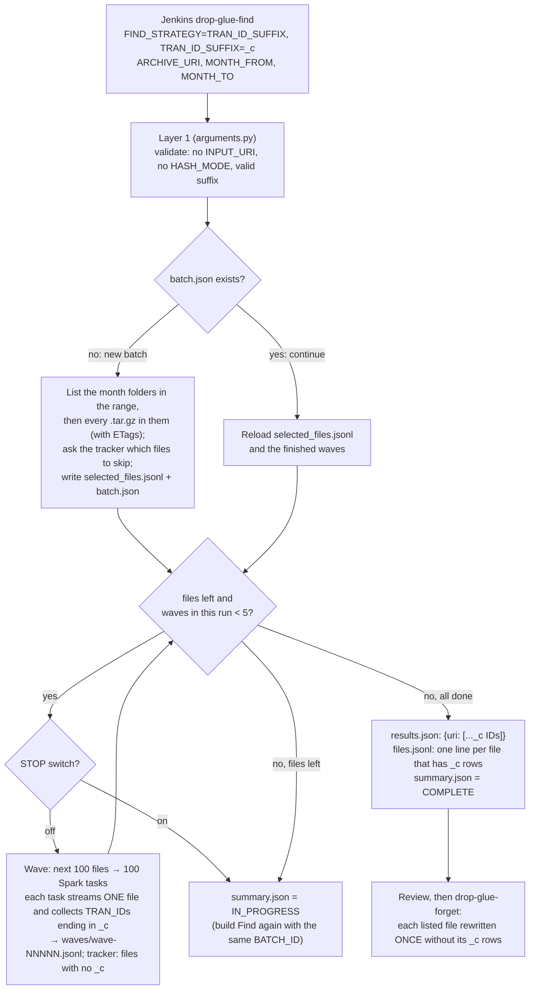

# Scenario report: `TRAN_ID_SUFFIX` (`_c`) on a 3-month archive

How Find and Forget process a real archive with `FIND_STRATEGY=TRAN_ID_SUFFIX`. It covers what happens wave by wave and run by run, how long it takes and what it costs, for **one month** compared with **all three months**.

Prices, formulas and per-file speeds come from [COST_ESTIMATE.md](COST_ESTIMATE.md). They are **estimates until a pilot is measured**. Record pilot numbers in COST_ESTIMATE.md section 5 and update this report.

| | |
|---|---|
| Date | 2026-11-18 |
| Region / prices | us-east-1 list prices: Glue $0.44 per DPU-hour, S3 Standard |

---

## 1. The scenario

```text
s3://data-lake/DBD001/archive/
├── 2026-01-01/  AB_CDEFG_DATA_01_part_0001.tar.gz … _part_0800.tar.gz   800 files × 100 MB
├── 2026-02-01/  AB_CDEFG_DATA_02_part_0001.tar.gz … _part_0800.tar.gz   800 files × 100 MB
└── 2026-03-01/  AB_CDEFG_DATA_03_part_0001.tar.gz … _part_0800.tar.gz   800 files × 100 MB
                                                                total 2,400 files, 240 GB
```

| Setting | Value | Effect |
|---|---|---|
| Files per wave | 100 | 100 files processed at the same time |
| Max waves | 5 | a Glue run stops after 5 waves = **500 files per run** |
| Workers | 26 × G.1X (Terraform default) | 1 driver + 25 executors × 4 slots = exactly 100 files at once |
| Find strategy | `TRAN_ID_SUFFIX`, suffix `_c` | no input file, no XML parsing |
| Part size | 100 MB `.tar.gz`, about **500 MB CSV** inside (assumed 5:1) | |

### Assumed speed per file (100 MB `.tar.gz`)

| Step | Per file | One wave (slowest file + ~3 s) |
|---|---|---|
| Find: GET 100 MB, gunzip, read 500 MB of CSV, check `TRAN_ID.endswith("_c")` | ~30 s | **~33 s** |
| Forget: the same read, plus write 500 MB CSV, gzip, PUT 100 MB, marker | ~90 s | **~93 s** |
| Fixed cost of every Glue run (Spark start, listing, reports, stop-switch checks) | | **~75 s** |

---

## 2. How `_c` mode works, step by step



**What one Spark task does with one file:**
1. One `GetObject` of the 100 MB `.tar.gz`, read as a stream. The file is never fully loaded into memory and not written to disk.
2. Checks that the archive holds exactly one CSV, named after the part, with the expected header.
3. Reads the rows one by one and keeps the `TRAN_ID`s that end with `_c`. The check is **case-sensitive**, so `_C` does not match. The `RAW_RESPONSE` XML is **not** parsed.
4. Returns `{uri, etag, version_id, rows, seconds, matches: {"SUFFIX": ["1001_c", …]}}`. A file it can't read is returned as `FAILED`, and the rest of the wave carries on.

**Outputs when the batch is COMPLETE** (`results/<BATCH_ID>/`):

| File | Contents |
|---|---|
| `results.json` | One document: `{"find_strategy": "TRAN_ID_SUFFIX", "tran_id_suffix": "_c", "match_result": "MATCH", "match_count": N, "data_identifier": {"s3://…part_0001.tar.gz": ["…_c", …], …}}` |
| `files.jsonl` | Forget's work list: **one line per file that contains `_c` rows**, with every `_c` ID of that file. Files without `_c` rows aren't listed and are never rewritten. |
| `summary.json` | Counts: `files_total`, `files_done`, `files_failed`, `files_to_rewrite`, `rows_to_delete`, `files_skipped_tracked` |

---

## 3. Case 1: a single month (`MONTH_FROM=2026-01`, `MONTH_TO=2026-01`)

### 3.1 What is selected

Only the folder `2026-01-01/` matches; `2026-02-01/` and `2026-03-01/` are not listed. That gives **800 files** (one LIST page, since S3 returns up to 1,000 keys per page). They are sorted by key, part_0001 to part_0800.

### 3.2 How the 800 files are processed

800 files ÷ 100 per wave = **8 waves**. At 5 waves per run, that is **2 Glue runs**:

| Glue run | How it starts | Waves | Files | Result |
|---|---|---|---|---|
| Run 1 | Jenkins find, `BATCH_ID` empty (new batch) | wave-00001 … wave-00005 | part_0001 – part_0500 | `IN_PROGRESS` 500/800 |
| Run 2 | Jenkins find again with **the same `BATCH_ID`**, other fields empty | wave-00006 … wave-00008 | part_0501 – part_0800 | `COMPLETE` 800/800, results.json and files.jsonl written |

```mermaid
gantt
  title Find, one month (800 files): 2 runs, 8 waves
  dateFormat  ss
  axisFormat  %M:%S
  section Run 1
  start-up            :a0, 00, 75s
  waves 1-5 (500 files) :a1, after a0, 165s
  section Run 2
  start-up            :b0, after a1, 75s
  waves 6-8 (300 files) :b1, after b0, 99s
```



### 3.3 Duration and cost: Find

| Run | Billed seconds | DPU-hours (26 workers) | Cost |
|---|---|---|---|
| Run 1 | 75 + 5 × 33 = 240 s | 1.73 | $0.76 |
| Run 2 | 75 + 3 × 33 = 174 s | 1.26 | $0.55 |
| **Find total** | **414 s ≈ 7 min** | 2.99 | **$1.32** |

Wall-clock time also includes the gap between the two Jenkins builds (from seconds if automated to however long it takes someone to click), plus up to about a minute of Glue start-up queueing per run.

### 3.4 Duration and cost: Forget

Forget rewrites only the files listed in `files.jsonl`, with the same 100 × 5 throttling.

| How many of the 800 files contain `_c` rows | Waves → runs | Billed time | Cost |
|---|---|---|---|
| **All 800** (worst case) | 8 → 2 runs (5 + 3) | (75 + 5 × 93) + (75 + 3 × 93) = 540 + 354 = **894 s ≈ 15 min** | **$2.84** |
| 25% (200 files) | 2 → 1 run | 75 + 2 × 93 = 261 s ≈ 4.5 min | $0.83 |
| 10% (80 files) | 1 → 1 run | 75 + 93 = 168 s ≈ 3 min | $0.53 |

### 3.5 Total for one month

| | Worst case (all 800 rewritten) |
|---|---|
| Find | $1.32 (≈ 7 min) |
| Forget | $2.84 (≈ 15 min) |
| S3 requests, logs, DynamoDB tracker | ≈ $0.03 |
| **One-time total** | **≈ $4.20, about 22 min of Glue time in 4 runs** |
| Old versions with `REPLACE_KEEP_VERSIONS` (800 × 100 MB = 80 GB) | + $1.84 per month |
| … with `REPLACE_TAG_FOR_LIFECYCLE` (7 days) | + $0.43 once |
| … with `REPLACE_PURGE_OLD_VERSIONS` | + $0 |

---

## 4. Case 2: all three months (`MONTH_FROM=2026-01`, `MONTH_TO=2026-03`)

Leaving both months empty selects the same three folders here, plus any `.tar.gz` sitting directly in the archive root.

### 4.1 What is selected

Three folders × 800 = **2,400 files**, in one batch, sorted by key. That puts January (files 1–800) first, then February (801–1,600), then March (1,601–2,400).

### 4.2 How the 2,400 files are processed

2,400 ÷ 100 = **24 waves**. At 5 waves per run, that is **5 Glue runs**, and a wave may contain files from two months:

| Glue run | Waves | Files covered |
|---|---|---|
| Run 1 (new batch) | 1 – 5 | Jan part_0001 – 0500 |
| Run 2 (same BATCH_ID) | 6 – 10 | Jan part_0501 – 0800, Feb part_0001 – 0200 |
| Run 3 | 11 – 15 | Feb part_0201 – 0700 |
| Run 4 | 16 – 20 | Feb part_0701 – 0800, Mar part_0001 – 0400 |
| Run 5 | 21 – 24 | Mar part_0401 – 0800 → `COMPLETE` |

`results.json` and `files.jsonl` are written **only after run 5**, so Forget can't start on any month until all three are scanned.

### 4.3 Duration and cost: Find

| Run | Billed seconds | Cost |
|---|---|---|
| Runs 1–4 | 4 × (75 + 5 × 33) = 4 × 240 = 960 s | 4 × $0.76 = $3.05 |
| Run 5 | 75 + 4 × 33 = 207 s | $0.66 |
| **Find total** | **1,167 s ≈ 19.5 min** (8.43 DPU-hours) | **$3.71** |

### 4.4 Duration and cost: Forget

| Files containing `_c` rows | Waves → runs | Billed time | Cost |
|---|---|---|---|
| **All 2,400** (worst case) | 24 → 5 runs | 4 × 540 + (75 + 4 × 93) = 2,160 + 447 = **2,607 s ≈ 43.5 min** | **$8.28** |
| 25% (600 files) | 6 → 2 runs | 540 + (75 + 93) = 708 s ≈ 12 min | $2.25 |
| 10% (240 files) | 3 → 1 run | 75 + 3 × 93 = 354 s ≈ 6 min | $1.12 |

### 4.5 Total for three months

| | Worst case (all 2,400 rewritten) |
|---|---|
| Find | $3.71 (≈ 19.5 min) |
| Forget | $8.28 (≈ 43.5 min) |
| S3 requests (≈ 2,400 GET for Find; ≈ 2,400 GET + 4,800 PUT for Forget), logs, DynamoDB | ≈ $0.10 |
| **One-time total** | **≈ $12.10, about 63 min of Glue time in 10 runs** |
| Old versions with `REPLACE_KEEP_VERSIONS` (2,400 × 100 MB = 240 GB) | + $5.52 per month |
| … with `REPLACE_TAG_FOR_LIFECYCLE` (7 days) | + $1.29 once |
| … with `REPLACE_PURGE_OLD_VERSIONS` | + $0 |

---

## 5. Side by side

| | **1 month** | **3 months, one batch** | **3 months, one batch per month** |
|---|---|---|---|
| Files | 800 | 2,400 | 3 × 800 |
| Find waves / runs | 8 / 2 | 24 / 5 | 24 / 6 (2 per month) |
| Find Glue time / cost | 7 min / $1.32 | 19.5 min / $3.71 | 21 min / $3.96 |
| Forget, worst case: runs / time / cost | 2 / 15 min / $2.84 | 5 / 43.5 min / $8.28 | 6 / 45 min / $8.52 |
| **Total, worst case** | **≈ $4.20** | **≈ $12.10** | **≈ $12.60** |
| Jenkins builds (Find + Forget) | 4 | 10 | 12 |
| Forget can start | after 2 Find runs | after all 5 Find runs | month by month, after each month's 2 runs |
| Review | one month at a time | everything at once | one month at a time |

**Which to choose:**
- **One batch for all three months** is about 4% cheaper (fewer runs, so less start-up time) and needs fewer builds.
- **One batch per month** gives smaller reviews, lets Forget start on January while February is still being scanned (Find and Forget are separate Glue jobs, each limited to one run at a time), and makes a bad month easy to redo.
- At this size, the cost difference (~$0.50) matters less than how you want to review.

---

## 6. What changes the numbers

| Change | Effect |
|---|---|
| `MAX_WAVES=0` (no cap) | One run per job: 3-month Find = 75 + 24 × 33 = 867 s → **$2.75** (saves $0.96); worst-case 3-month Forget = 75 + 24 × 93 = 2,307 s → **$7.33** (saves $0.95). The trade-off is a single long run with no natural pause, although the stop switch still works before every wave. |
| Fewer workers, e.g. 6 (20 at once), `FILES_PER_WAVE=20`, `MAX_WAVES=0` | 3-month Find = 75 + 120 × 33 = 4,035 s ≈ 67 min on 6 DPU → **$2.96**. Slower in wall time; costs less only because the fixed start-up and the slowest-file wait are paid on fewer DPUs. |
| Re-running the same months after a complete Find + Forget (DynamoDB tracker on) | Every file is either CLEANED or SCANNED_NO_MATCH with an unchanged ETag, so **0 of 2,400 are scanned**. Only the start-up of each run is paid (~$0.24 per run). |
| Files that really contain about 100 MB of CSV (not 500 MB) | Roughly 5× faster per file; see COST_ESTIMATE.md section 3 (500 files ≈ $1.00 for Find + Forget). |
| Parts not in S3 Standard (Standard-IA, Glacier IR) | Adds a retrieval fee per GB: 240 GB read twice (Find + Forget) at e.g. $0.01–0.03 per GB ≈ **$5–15**, plus minimum-storage charges on the replaced versions. This can cost more than Glue. |
| Glue run timeout (480 min) | Not a concern: the longest run here is about 9 min. |

---

## 7. Resources used per run (sanity check)

| Resource | Find | Forget |
|---|---|---|
| Memory per task | small: rows are streamed one by one | small: rows are streamed |
| Local disk per task | none | ~500 MB CSV + ~100 MB archive in temporary files. 4 tasks × 0.6 GB = 2.4 GB of the 64 GB on a G.1X. |
| S3 bandwidth per wave | 100 × 100 MB = 10 GB read in ~33 s (~300 MB/s total) | 10 GB read + 10 GB written in ~93 s |
| DynamoDB per batch (3 months) | 24 BatchGetItem calls (100 keys each) + writes for files with no `_c` rows | ≤ 2,400 writes (CLEANED) |

---

## 8. Running the scenario: Jenkins steps

**One month (January):**
1. `drop-glue-find`: set `FIND_STRATEGY=TRAN_ID_SUFFIX`, `TRAN_ID_SUFFIX=_c`, `ARCHIVE_URI=s3://data-lake/DBD001/archive/`, `MONTH_FROM=2026-01`, `MONTH_TO=2026-01`, and leave `INPUT_URI` and `BATCH_ID` empty. Note the batch ID it prints.
2. `drop-glue-status` with that batch ID: when the Glue run ends, it shows `IN_PROGRESS 500/800`.
3. `drop-glue-find` with **only `BATCH_ID`** set, which runs waves 6–8 → `COMPLETE`.
4. Review `results.json` / `summary.json` (`files_to_rewrite`, `rows_to_delete`).
5. `drop-glue-forget` with the batch ID typed twice and a `FORGET_STRATEGY`. Repeat with the same batch ID while `remove_summary.json` says `IN_PROGRESS`.

**Three months:** the same steps with `MONTH_TO=2026-03`, and step 3 repeated four times (runs 2–5).

---

## 9. Measured results (fill in after the pilot)

| Date | Case | Job | Run | Files | Waves | Run seconds (`ExecutionTime`) | Slowest file (s) | Cost (s × 26 / 3600 × $0.44) |
|---|---|---|---|---|---|---|---|---|
| | 1 month | find | 1 | 500 | 5 | | | |
| | 1 month | find | 2 | 300 | 3 | | | |
| | 1 month | forget | 1 | | | | | |
